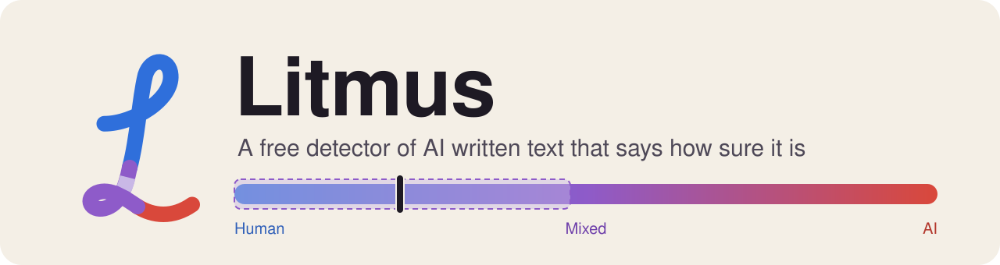
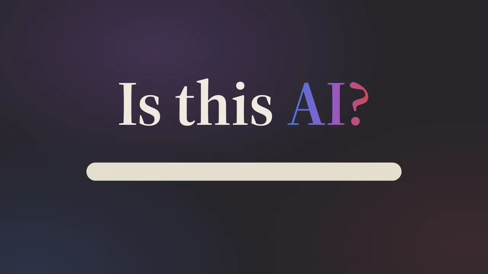
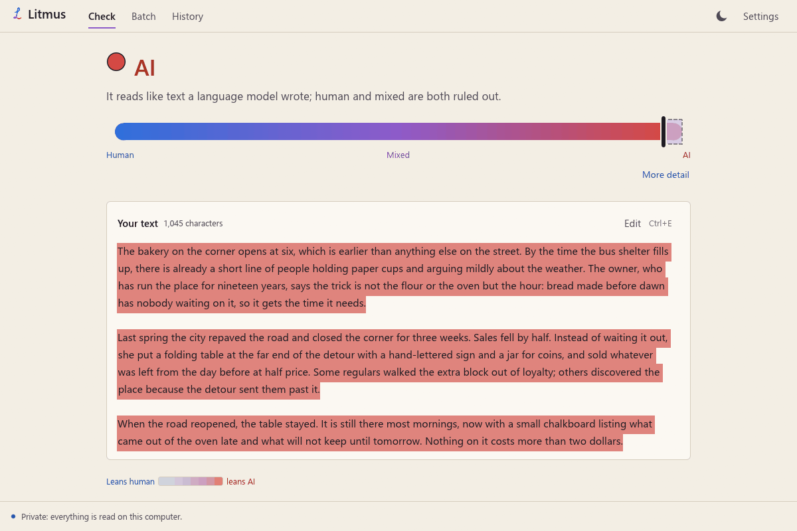
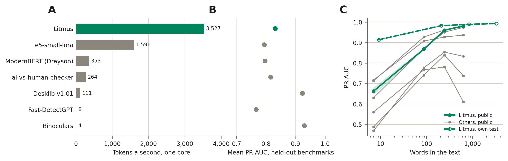
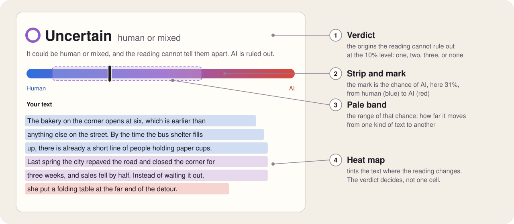

<picture>
  <source media="(prefers-color-scheme: dark)" srcset="docs/images/banner_dark.svg">
  
</picture>

Litmus is a free detector of AI written text that says how sure it is.

**[Website](https://lhallee.github.io/litmus/)** · **[Check text in your browser](https://lhallee.github.io/litmus/app/)** ·
**[Download](https://github.com/lhallee/litmus/releases/latest)**

<a href="https://lhallee.github.io/litmus/"></a>

Paste in a passage and Litmus tells you whether it reads as written by a person, by AI, or by both together, and when
the evidence cannot decide, it says "Uncertain" instead of guessing. It runs on your own computer or inside your
browser, so the text you check never leaves your device, and it is free for any noncommercial use. The longer the
text, the surer the reading.

[Get Litmus](#get-litmus) · [Speed and accuracy](#speed-and-accuracy) · [Reading a result](#reading-a-result) ·
[Using it well](#using-it-well) · [How it works](#how-it-works) · [Privacy](#your-text-stays-with-you) ·
[AI agents](#use-it-from-an-ai-agent) · [License](#license-and-citation)

## Get Litmus

- **Windows.** Download `litmus-app.exe` from <!--litmus:t:latest_release_link-->[the latest release](https://github.com/lhallee/litmus/releases/latest)<!--/litmus--> and run it. There is
  nothing to install and no account, and it works offline. Windows may warn that the file comes from an unrecognized
  publisher, since <!--litmus:target.programs.signing_note-->the release's programs are not code-signed<!--/litmus-->.
- **macOS.** Download `litmus-app-macos-arm64` (Apple silicon) or `litmus-app-macos-x86_64` (Intel) from <!--litmus:t:latest_release_link-->[the latest release](https://github.com/lhallee/litmus/releases/latest)<!--/litmus-->.
  In a terminal, make it executable with `chmod +x litmus-app-macos-arm64`, remove the mark macOS puts on a download
  that is not code-signed with `xattr -d com.apple.quarantine litmus-app-macos-arm64`, and run it.
- **Linux.** Download `litmus-app-linux-x86_64` from <!--litmus:t:latest_release_link-->[the latest release](https://github.com/lhallee/litmus/releases/latest)<!--/litmus-->, make it executable
  with `chmod +x litmus-app-linux-x86_64`, and run it on any 64-bit x86 desktop with glibc 2.17 or later.
- **In your browser.** Open <!--litmus:target.github.pages_url-->https://lhallee.github.io/litmus/<!--/litmus-->app/ and paste or drop your text. The page
  downloads the model once, ~<!--litmus:model.files_bytes as mb1-->18.5 MB<!--/litmus-->, and then checks everything inside your browser.

The app adds quick check, which you switch on in Settings: select text in any application, press Ctrl+Alt+L, and a
small window by the pointer shows the reading. On Linux, quick check needs `xclip` and an X11 desktop, and it works
while the app's window is open. On macOS it needs the Accessibility permission, and it has not been tried on a Mac
yet, so tell us how it goes.

<picture>
  <source media="(prefers-color-scheme: dark)" srcset="docs/images/app_simple_dark.png">
  
</picture>

## Speed and accuracy

Litmus needs no graphics card. <!--litmus:t:speed_summary-->On one CPU core the app reads ~4,900 tokens (pieces of words) a second, on the 16 logical processors of the same machine ~33,000, and the browser page ~890.<!--/litmus-->

We compared Litmus with <!--litmus:counts.detectors-->6<!--/litmus--> other open detectors on <!--litmus:counts.benchmarks-->14<!--/litmus--> public benchmarks, <!--litmus:t:speed_comparison-->on the same texts, the others timed on one core of Intel(R) Xeon(R) Platinum 8358 CPU @ 2.60GHz and Litmus on one core of Arm Neoverse-V2<!--/litmus-->. On one core Litmus read ~<!--litmus:results.costs[detector=Litmus engine].tokens_per_second as sig2-->3,500<!--/litmus--> tokens a second, against
~<!--litmus:counts.fastest_other_tokens_per_second as sig2-->1,600<!--/litmus--> for the fastest of the others, and on the <!--litmus:counts.unseen_benchmarks-->7<!--/litmus--> benchmarks that none of them trained on,
<!--litmus:counts.more_accurate_unseen-->2<!--/litmus--> of the <!--litmus:counts.detectors-->6<!--/litmus--> were more accurate.

Litmus gets more accurate the more it reads. Across the public benchmarks its PR AUC (1.0 is perfect) rises from
<!--litmus:lengths.rows[benchmark=pooled,task=ai_vs_human,subset=1-50,detector=Litmus,metric=pr_auc].value as f2-->0.66<!--/litmus--> on texts of 50 words or fewer, through <!--litmus:lengths.rows[benchmark=pooled,task=ai_vs_human,subset=51-150,detector=Litmus,metric=pr_auc].value as f2-->0.87<!--/litmus--> at 51-150 words and <!--litmus:lengths.rows[benchmark=pooled,task=ai_vs_human,subset=151-400,detector=Litmus,metric=pr_auc].value as f2-->0.96<!--/litmus--> at 151-400, to
<!--litmus:lengths.rows[benchmark=pooled,task=ai_vs_human,subset=401-1000,detector=Litmus,metric=pr_auc].value as f2-->0.98<!--/litmus--> at 401-1,000 words, where Binoculars scores <!--litmus:lengths.rows[benchmark=pooled,task=ai_vs_human,subset=401-1000,detector=Binoculars,metric=pr_auc].value as f2-->0.94<!--/litmus-->.

<picture>
  <source media="(prefers-color-scheme: dark)" srcset="docs/images/benchmarks_speed_dark.png">
  
</picture>

*Speed on one CPU core (A), accuracy on the public benchmarks that no detector trained on (B), and accuracy by text
length (C), with every detector run on the same texts and timed on one processor core (the processors are named
above). <!--litmus:t:speed_two_measures-->Litmus's speed in A, ~3,500 tokens a second, was timed over the benchmarks' short texts on one core of Arm Neoverse-V2. The app's ~4,900 is one 28,920-token document read on one core of AMD Ryzen 7 3800X 8-Core Processor.<!--/litmus--> In C the solid lines are the public
benchmarks, and the dashed line is Litmus on its own held-out test split, whose token counts are converted to words.
PR AUC is 1.0 for a perfect detector, and the intervals are 95%.*

The site's [Results](https://lhallee.github.io/litmus/benchmarks.html) page explains the comparison and what it can and
cannot show.

## Reading a result

<picture>
  <source media="(prefers-color-scheme: dark)" srcset="docs/images/anatomy_dark.svg">
  
</picture>

- **The verdict** reads "Human", "AI", or "Mixed" when the evidence points one way, "AI or mixed" when human is ruled
  out and it cannot tell whether a model wrote all of the text or part, and "Uncertain" when it cannot rule human out,
  naming the origins that remain. "Unlike reference" means the text resembles nothing Litmus knows well enough to call.
- **The chance of AI** is how likely it is that a language model wrote or edited some of the text, taking a text to
  be as likely human as not before it is read. It comes with a range, as in <!--litmus:t:chance_range_example-->50% (19-81%)<!--/litmus-->, because the same
  reading means a somewhat different chance in one kind of text than in another. The range holds the chance for
  <!--litmus:t:chance_range_rule-->90% of the pairings of one human source with one AI or mixed source, which is 4.2 times the odds in either direction<!--/litmus-->, so it is short near
  either end and wide in the middle. We recommend reading it before the number.
- **The strip** runs from human (blue) to AI (red). The mark sits at the chance of AI, and the pale band is that
  chance's range, so the picture and the number say the same thing.
- **The heat map** tints a long text where its reading changes, to show where to look.

Litmus is built so that at most 5% of human texts like the ones it was calibrated on are called not human. The site's
[Reading a result](https://lhallee.github.io/litmus/reading.html) page explains each part.

## Using it well

A reading is evidence about where a text came from, never proof of who wrote it, and what you do with it is your own
decision. We recommend never using a reading alone to accuse anyone or to decide something about a person, and
weighing it beside what it cannot see, such as drafts, version history, the writer's other work, and a conversation
with the writer. If you act on a reading, show the person what it said.

- **It cannot say who wrote a text, or why,** so it cannot tell whether a model was used with permission or only to
  fix spelling, and it does not measure how much of a mixed text a model wrote.
- **Longer texts give surer readings.** A sentence or two carries little evidence, so the chance of AI stays nearer
  the middle and the verdict is more often "Uncertain". Check a paragraph or more when you can.
- **It reads English only for now.** Other languages are not supported yet.
- **New models and unusual formats** can fall outside what it has seen, and the "Unlike reference" verdict catches
  some of these, not all.

## How it works

Litmus decides where a text came from by asking which known texts it resembles. A small model turns your text into a
summary and compares it with a bank of reference texts of known human, AI, and mixed origin, and calibration turns that
comparison into the verdict and its range. It learned from public datasets only. The site's
[How it works](https://lhallee.github.io/litmus/how.html) page walks through each step, and
[How Litmus is made](docs/TRAINING.md) covers the training in full.

## Your text stays with you

The app and the browser page check text on your own device. The app contains no code that connects to the network,
and the browser page only downloads its own files and the model. [SECURITY.md](SECURITY.md) says what each part of
Litmus does with your computer and your text, and [AUDIT.md](docs/AUDIT.md) shows anyone how to check it.

To help improve Litmus, <!--litmus:t:contribute_address-->The contribute site, once it is live,<!--/litmus--> is the one place where you can choose to send a
text. It keeps the text privately, with the reading and any label you give, to train later versions, and never
publishes it. Please share only text you are willing to share with us.

## Use it from an AI agent

A coding agent such as Claude Code or Codex can install the `litmus` command and check text or code as part of its
work, and the `litmus` skill tells it how to read a result and when not to trust one.
[Use Litmus from an AI agent](docs/USE_WITH_AGENTS.md) has the setup for each client.

## For developers

[DEVELOPING.md](docs/DEVELOPING.md) covers building and running Litmus from source, the tests, how to verify a build,
and the full benchmark results. To report a security problem, see [SECURITY.md](SECURITY.md#reporting-a-vulnerability).

## Support

Litmus is free and has no paid tier. If you find it useful, you can support its development at
[paypal.me/lnblog](https://paypal.me/lnblog).

## License and citation

Litmus is source available and free for any noncommercial use under the
[PolyForm Noncommercial License 1.0.0](LICENSE), including by schools, universities, charities, public research
bodies, and government institutions. Commercial use is not licensed. [LICENSING.md](LICENSING.md) says which terms
cover which file. Every copy passes along the license and this line:

```text
Required Notice: Copyright Logan Hallee (https://github.com/lhallee/litmus)
```

To cite Litmus: <!--litmus:t:citation-->Hallee, L. (2026). Litmus: a free detector of AI written text that says how sure it is [Computer software]. https://github.com/lhallee/litmus<!--/litmus-->.
