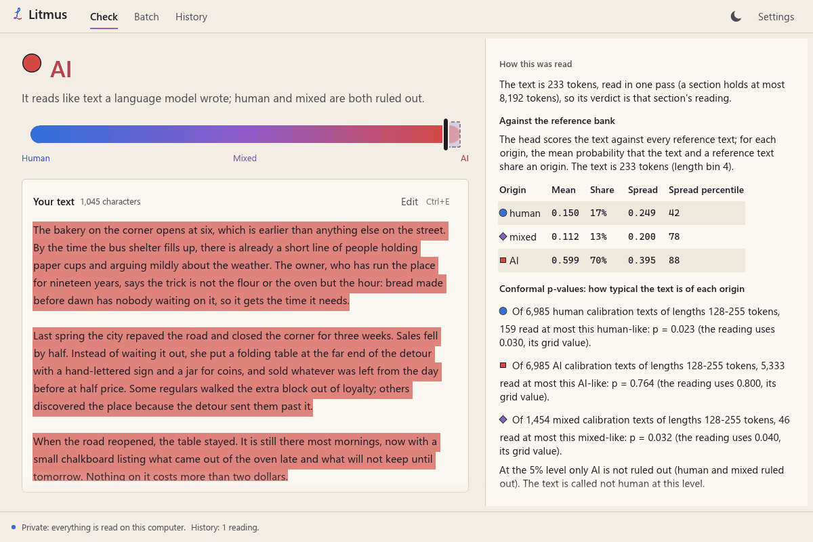
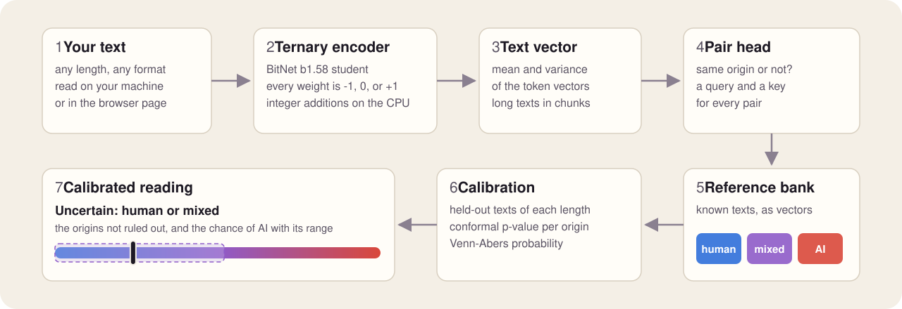

<picture>
  <source media="(prefers-color-scheme: dark)" srcset="docs/images/banner_dark.svg">
  
</picture>

Litmus is a free detector of AI written text that says how sure it is.

<a href="https://lhallee.github.io/litmus/"></a>

It runs on your own computer, or inside your browser, so the text you check stays with you. It reads a passage and
calls it human, AI, or mixed (written by a person and a model together), and when the evidence cannot separate the
origins it says "Uncertain" and shows which ones remain. It also shows where in a long text the reading changes, and
why it reached its answer. Litmus is free for any noncommercial use, and all of its code is published here so that
anyone can check what it does.

A reading is evidence about where a text came from, never proof of who wrote it. Short texts are less reliable, and
this release is an English detector: other languages are not supported yet.

<picture>
  <source media="(prefers-color-scheme: dark)" srcset="docs/images/app_simple_dark.png">
  
</picture>

*The app after a check shows the verdict, one sentence that explains it, the strip with its band over the origins not
ruled out, and the text tinted where the reading changes.*

## Get Litmus

There are three ways to use Litmus: the app on your computer, the page in your browser, and the contribute site. The
app and the page never send your text anywhere.

- **The Windows app.** Download `litmus-app.exe` from <!--litmus:t:latest_release_link-->[the latest release](https://github.com/lhallee/litmus/releases/latest)<!--/litmus--> and run it.
  There is nothing to install and no account, and it works offline. Checks run on your computer, and the app keeps
  its history and settings in your own user folder. Windows may warn that the file comes from an unrecognized
  publisher, since <!--litmus:target.programs.signing_note-->the release's programs are not code-signed<!--/litmus-->.

  Two things make the app worth the download. It is faster, though both are fast: <!--litmus:t:speed_sentence-->on one processor core (AMD Ryzen 7 3800X 8-Core Processor), reading a 28,920-token document, the app read about 28,267 tokens (word pieces) a second and the browser page about 5,540 (Chromium 156, 1 worker), so the document took about 1.0 seconds in the app and about 5.2 in the page<!--/litmus-->. And it
  has quick check: select text in any application, press Ctrl+Alt+L, and a small window by the pointer shows the
  reading. Quick check is off until you switch it on in Settings.
- **The Linux app.** Download `litmus-app-linux-x86_64` from <!--litmus:t:latest_release_link-->[the latest release](https://github.com/lhallee/litmus/releases/latest)<!--/litmus-->, make it
  executable with `chmod +x litmus-app-linux-x86_64`, and run it. It needs 64-bit x86 Linux with glibc 2.17 or later and a
  graphical desktop, and nothing installed. Quick check reads the selected text through `xclip`, its hotkey works on
  X11 and not on Wayland, and it works while the window is open, since the Linux app has no tray icon. The Linux app
  was tested on X11 only, and the Mac build is untested.
- **In your browser.** Open <!--litmus:target.github.pages_url-->https://lhallee.github.io/litmus/<!--/litmus-->app/ and paste or drop your text. The page downloads the
  model once, about <!--litmus:model.files_bytes as mb1-->10.8 MB<!--/litmus-->, and then checks everything inside your browser. Your
  text never leaves the page.
- **The contribute site.** <!--litmus:t:contribute_address-->The contribute site, once it is live,<!--/litmus--> is the one place where your text is sent to a
  server. It scores the text there and keeps it privately, with the reading and any label you give, to improve
  later versions of Litmus. The text is never published. Its terms sit beside the Check button, which works once you
  tick the box that accepts them, and the page has a form that asks for a text's removal. It stores no address,
  cookie, or account. Please do not paste sensitive information; we recommend using it only for text you are
  willing to share with us.

## Reading a result

<picture>
  <source media="(prefers-color-scheme: dark)" srcset="docs/images/anatomy_dark.svg">
  
</picture>

- **The verdict** names the origins the reading cannot rule out at the 10% level. One origin reads "Human", "AI", or
  "Mixed", two or three read "Uncertain", and none reads "Unlike reference", because the text resembles none of the
  reference texts closely enough for a call.
- **The strip** runs from human (blue) through mixed (purple) to AI (red). The mark is the reading's position, and
  the pale band covers every origin still possible, so a wide band means an unsure reading.
- **P(not human)**, the probability that a person did not write the text alone, comes with an interval. We
  recommend reading the interval before the number.
- **The levels** promise that among human texts like the ones Litmus was calibrated on, at most 5% are called not
  human at the 5% level. That bounds false flags, and it says nothing about how much AI text is caught.
- **The heat map** shows where to look in a long text, but the verdict decides, not its most extreme part.

<picture>
  <source media="(prefers-color-scheme: dark)" srcset="docs/images/app_full_explain_dark.png">
  
</picture>

*At the Full detail level a panel says how the reading was made, with the evidence behind each number.*

The site's [Reading a result](https://lhallee.github.io/litmus/reading.html) page explains each part.

## Our recommendations

What you do with a reading is your own decision. A reading is one piece of evidence, and these are our
recommendations for using it well:

- We recommend not using a reading alone to accuse anyone or to make a decision about a person.
- We recommend weighing it beside what it cannot see, such as drafts, version history, the writer's other work, and a
  conversation with the writer.
- We recommend reading the set and the interval, not just the verdict, and treating an "Unlike reference" reading as
  no evidence either way.
- If you act on a reading, we recommend showing the person what it said and the numbers behind it.

## What it cannot tell you

- **Who wrote the text, or why.** It reads the words on the page, not the process that made them, so it cannot say
  whether a model was used with permission, disclosed, or used only to fix spelling.
- **How much of a mixed text a model wrote.** The heat map shows where a long text's reading changes, and the verdict
  does not measure a share.
- **Anything certain about a short text.** Short texts are less reliable: a sentence or two carries little evidence,
  and the set and the interval stay wide to show it.
- **Anything reliable about a language other than English.** This release is an English detector:
  <!--litmus:record.corpus.english_share as pct1-->98.8%<!--/litmus--> of the text it learned from was English, it was tested mainly on English
  text, and other languages are not supported yet.
- **Anything reliable about text unlike its references.** New models and unusual formats can fall outside what it has
  seen, and the "Unlike reference" verdict catches some of these, not all.
- **Proof.** Some human text is called not human at the rate the level allows, and more often when it is unlike the
  calibration texts. Every human reference text predates 2022, and long AI text is scarce in public data.

## How accurate it is

These numbers come from texts Litmus never trained on, read once after the model was chosen.

| On held-out test texts | Value |
| --- | --- |
| Human texts wrongly called not human at the 5% level | <!--litmus:evaluation_test.rows[evaluation=passages,stratum=all,metric=human_called_not_human,level=0.05].value as pct1-->5.9%<!--/litmus--> |
| AI texts caught when 1% of human texts are wrongly flagged | <!--litmus:results.rows[benchmark=test,detector=Litmus,task=ai_vs_human].tpr_at_fpr_1 as pct1-->35.1%<!--/litmus--> |
| AI texts caught when 5% of human texts are wrongly flagged | <!--litmus:results.rows[benchmark=test,detector=Litmus,task=ai_vs_human].tpr_at_fpr_5 as pct1-->62.1%<!--/litmus--> |
| Texts whose verdict includes their true origin, at the 10% level | <!--litmus:evaluation_test.rows[evaluation=passages,stratum=all,metric=coverage,level=0.1].value as pct1-->89.5%<!--/litmus--> |

Litmus is also compared with <!--litmus:counts.detectors-->6<!--/litmus--> other detectors on <!--litmus:counts.benchmarks-->14<!--/litmus--> public benchmarks, each detector run on the same
machine and the same texts. The full tables, the controls, and every metric are in [DEVELOPING.md](docs/DEVELOPING.md#results-in-full), and the
site's [Results](https://lhallee.github.io/litmus/benchmarks.html) page says what such comparisons can and cannot show.

## How it works

<picture>
  <source media="(prefers-color-scheme: dark)" srcset="docs/images/how_it_works_dark.svg">
  
</picture>

Litmus decides where a text came from by asking which known texts it resembles. A small model turns your text into
a vector and compares it with a bank of reference texts of known human, AI, and mixed origin. The model is a BitNet
b1.58 encoder whose weights are all -1, 0, or +1, so it runs with integer additions on one processor core and needs
no graphics card. Calibration on texts held out for the purpose turns the comparison into the set of origins it
cannot rule out and a probability with an interval. Litmus learned from public datasets only, and no text was
generated for it. The site's [How it works](https://lhallee.github.io/litmus/how.html) page walks through each step, and
[How Litmus is made](docs/TRAINING.md) covers every step of training, from the public sources and the clustered
splits to the ternary model, the loss, calibration, every experiment, and the evaluation, with worked numbers.

## Your text stays with you

The app and the browser page check text on your own device. The app contains no code that connects to the
network, and the browser page's only requests are for its own files and the model's files. The app's quick check,
which reads the text you select in another program when you press a hotkey, is off until you switch it on in
Settings, and it is the only part of the app that touches the clipboard or a global hotkey.

You do not have to take this on trust. [SECURITY.md](SECURITY.md) says what each part of Litmus does with your
computer, your files, and your text, and names the code behind each statement. Anyone, or their AI assistant, can
follow [AUDIT.md](docs/AUDIT.md) to check those statements, scan the code for every network call, and rebuild the app from
this code to compare it with a download. [DEVELOPING.md](docs/DEVELOPING.md#verify-the-build) says on which platforms that
comparison is verified.

## Use it from an AI agent

Point a coding agent (Claude Code, Codex, Antigravity, or any client of the Model Context Protocol) at this repository
and it can install the `litmus` command and check text or code as part of its own work. `litmus mcp` gives it two tools,
and the `litmus` skill tells it how to read a result and when not to trust one, including that a reading is evidence and
never an accusation. [Use Litmus from an AI agent](docs/USE_WITH_AGENTS.md) has the setup for each client.

## For developers and contributors

[DEVELOPING.md](docs/DEVELOPING.md) covers running Litmus from source (the command line, the Python module, the desktop
app, and the browser page), the tests and the one command that runs them all, the security checks, how to verify a
build, the full results, and a map of the repository. [SECURITY.md](SECURITY.md) and [AUDIT.md](docs/AUDIT.md) are the
security model and the audit guide. To report a security problem, see [SECURITY.md](SECURITY.md#reporting-a-vulnerability).

## Support

Litmus is free for noncommercial use and has no paid tier. If you find it useful and want to support its
development, you can donate at [paypal.me/lnblog](https://paypal.me/lnblog).

## License and citation

Litmus is source available and free for any noncommercial use under the
[PolyForm Noncommercial License 1.0.0](LICENSE), including by schools, universities, charities, public research
bodies, and government institutions; commercial use is not licensed. [LICENSING.md](LICENSING.md) says which terms
cover which file. Every copy passes along the license and this line:

```text
Required Notice: Copyright Logan Hallee (https://github.com/lhallee/litmus)
```

To cite Litmus: <!--litmus:t:citation-->Hallee, L. (2026). Litmus: a free detector of AI written text that says how sure it is [Computer software]. https://github.com/lhallee/litmus<!--/litmus-->.
