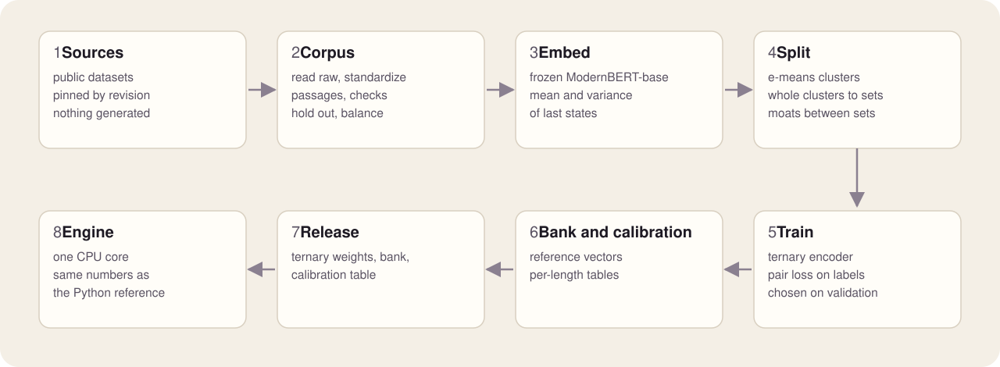

# How Litmus is made

This is the full account of how the Litmus model is trained: where every text comes from and how it is labeled, how
the texts are split so that nothing near a test text is trained on, what the model computes at every step, the loss
it learns from, how a raw score becomes a calibrated reading, every experiment that shaped the design, how the
model is evaluated, how the engine reads it on one processor core, and the commands that rebuild it.

It is written for a technically literate reader who is not a machine learning specialist. Every symbol is defined
where it first appears, every operation is shown as matrix arithmetic with its shapes, and every step is worked on a
small made-up example. A specialist who wants to reproduce the model will find the exact settings, the formulas, and,
for every formula, the function in this repository that computes it.

> [!NOTE]
> The released model comes from a second build of the corpus and a single training run from scratch on the true labels
> alone, with no teacher, in a recipe that short ablations tested and left unchanged. Values that this build sets are
> filled from its data files when the release is cut, never typed. The method,
> the formulas, the worked examples, and the finished experiments do not change with the build.

<picture>
  <source media="(prefers-color-scheme: dark)" srcset="images/training/pipeline_dark.svg">
  
</picture>

*The whole pipeline. Steps 1 to 4 build and split the data; steps 5 to 7 train the model and package it; step 8 is
the program that reads it.*

## Contents

| Part | What it covers |
| --- | --- |
| [What Litmus answers](#what-litmus-answers) | The three origins, what a reading holds, long texts, and what a reading does not claim |
| [1. The data](training/data.md) | The source table, how each row is labeled, the eight corpus stages, deduplication, the benchmark hold-out, balance, the token budget, and the counts |
| [2. The splits](training/splits.md) | Embedding with a frozen encoder, e-means clustering, whole clusters to the held-out sets with moats between them, the banks, and a worked toy split |
| [3. The model](training/model.md) | Ternary weights and 8-bit activations, the encoder layer, block attention, pooling, the pair head, the reference bank, chunks and windows, and a forward pass worked by hand |
| [4. Training](training/training.md) | The true-label pair loss with a 3 by 3 worked example, batches, the gradient-cached step, the schedule, and how the checkpoint is chosen |
| [5. Calibration and the reading](training/calibration.md) | Conformal p-values and sets, Venn-Abers probabilities, what Uncertain means, and how chunks combine |
| [6. The experiments](training/experiments.md) | One card per experiment: the question, arms, data, measurement, result, what it changed, and its limits |
| [7. Evaluation](training/evaluation.md) | The held-out test split, the public benchmarks, the metrics and their intervals, and the cost on one core |
| [8. The engine](training/engine.md) | Packed ternary kernels, the zero-skipping column path, the browser build, parity with the reference, and reproducible builds |
| [9. Reproduce it](training/reproduce.md) | The commands in order, the compute, and the map from every formula to the code |

## What Litmus answers

Litmus answers one question about a text: **which origins of writing could have produced it?** It knows three.

| Origin | Label | What it means in the training data |
| --- | --- | --- |
| Human | 0 | Written by a person. Every human text is dated before 2022 by a date column or by its source's own date, before chat models were in wide use |
| AI | 1 | Written by a language model. Every AI text names the model that wrote it where its source says |
| Mixed | 2 | Written by a person and a model together: model text edited by a person, human text polished, paraphrased, continued, or “humanized” by a model. Each mixed text records how it was mixed where its source says |

A reading is not a single score. For each text Litmus reports:

- **A verdict word.** *Human*, *AI*, or *Mixed* when exactly one origin is left standing; *Uncertain* when two or
  three are; *Unlike reference* when the text resembles none of the reference texts closely enough for a call.
- **A conformal p-value for each origin,** and the set of origins not ruled out at the 5% and 10% levels. A p-value
  is the share of known texts of that origin and about that length that looked less like it than this text does. The
  guarantee is concrete: among human texts like the calibration texts, at most 5% are called not human at the 5% level.
- **A probability that the text is not human, with an interval** whose width shows how much evidence the calibration
  texts hold near this score.
- **Three-way probabilities,** drawn as a position on the litmus strip (blue human, purple mixed, red AI) with a band
  over the origins that cannot be ruled out.
- **Its evidence:** the five most similar reference texts with their source, generator, domain, format, and language,
  and the calibration counts behind each p-value, so a person can check how the reading was made.
- **For a long text,** a reading per chunk of at most 8,192 tokens (a token is a word or a piece of one), a verdict that
  combines the chunks by a rule valid however alike they are, a signal when one chunk reads as human and another as
  model-written, and a heat map in cells of 128 tokens that shows where the reading changes.

**What a reading does not claim.** It reads the words on the page, not the process that made them, so it cannot say
who wrote a text, why, whether a model was used with permission, or how much of a mixed text a model wrote. A short
text carries little evidence, and the band and the interval stay wide to show it. Text unlike the reference (new
models, languages other than English, unusual formats) can fall outside what Litmus has seen; the *Unlike reference*
verdict catches some of it, not all. This release is trained almost wholly on English text and its held-out test set
is English only; it reads other languages, but only a few public benchmarks measure them, so we recommend extra caution
with a reading of a text that is not in English. The 5% bound limits false flags on human text like the calibration texts; it says nothing about
how much AI text is caught, which [the evaluation](training/evaluation.md) measures.

**Our recommendations.** We recommend reading the verdict together with its band and interval, treating *Uncertain*
as the answer it is, and not using a reading alone to accuse anyone of anything. These are recommendations; the
decision is the reader's.

## How to read this document

- **Notation.** Lowercase letters are scalars and vectors ($`x`$, $`\gamma`$), uppercase letters are matrices
  ($`X`$, $`W`$), and dimensions are lowercase ($`n`$ tokens, $`d`$ width). One row is one token or one text, and a
  weight matrix is stored as (outputs by inputs), as the release file stores it, so a product is $`Y = X W^{\top}`$.
- **Symbol tables** in each part give every symbol's meaning, whether it is **fixed** (learned once, then shipped) or
  **computed** (new for every text), its shape, and its shape in `s192_l4`, the smallest model (1.0.0's release; 1.1 is `s512_l6`).
- **Worked numbers** are made up to show the arithmetic, and say so. They were computed with this repository's own
  functions, so they match what the code does.
- **Diagrams** color computed values teal and fixed weights ochre, in every figure that shows both.
- **Deeper layers** sit in collapsed sections marked *More detail*; the main text reads without them.
- **Sources.** Every number comes from this repository's documents and code, the runs of the experiments in part 6,
  or the cited papers. The account describes the release <!--litmus:t:release_identity-->`v1.1.0` (model lhallee/litmus-third-build at commit d1b3e3a9f8342a298c1bb61605f479f175cf9a06)<!--/litmus-->.
- **Contract.** Where this account and the code differ, the code is right: [`student/SPEC.md`](../student/SPEC.md)
  and [`student/reference.py`](../student/reference.py) define the model's arithmetic, and
  [`teacher/CALIBRATION.md`](../teacher/CALIBRATION.md) the calibration table.
