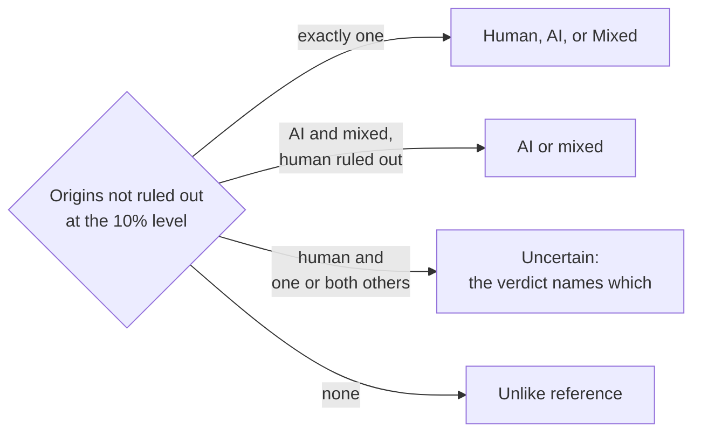

# 5. Calibration and the reading

[Front page](../TRAINING.md) · [1. Data](data.md) · [2. Splits](splits.md) · [3. Model](model.md) ·
[4. Training](training.md) · **5. Calibration** · [6. Experiments](experiments.md) · [7. Evaluation](evaluation.md) ·
[8. Engine](engine.md) · [9. Reproduce](reproduce.md)

The model gives a text three **shares**, $`r_{\mathrm{human}}`$, $`r_{\mathrm{AI}}`$, $`r_{\mathrm{mixed}}`$
([3. The model](model.md#the-reference-bank)). A share of 0.57 is not a probability: what it means depends on how
texts of known origin, and of about the same length, score. **Calibration** answers that by comparison with the
**calibration split**, texts the model never trained on, read through the released model and bank when the release is
exported. It fits a small table (about 27 KB of JSON) that ships inside the release, and every reading applies it.
The table's exact layout is [`teacher/CALIBRATION.md`](../../teacher/CALIBRATION.md); the code is
`litmus_teacher.calibrate` (`fit_calibration` fits, `apply_calibration` applies).

- [Length groups](#length-groups)
- [Conformal p-values and sets](#conformal-p-values-and-sets)
- [What Uncertain means](#what-uncertain-means)
- [The probability of not human, with an interval](#the-probability-of-not-human-with-an-interval)
- [The chance of AI](#the-chance-of-ai)
- [The range between sources](#the-range-between-sources)
- [Three-way probabilities and the strip](#three-way-probabilities-and-the-strip)
- [The mechanism's own signals](#the-mechanisms-own-signals)
- [Long documents: combining chunks](#long-documents-combining-chunks)
- [A reading worked end to end](#a-reading-worked-end-to-end)
- [What the guarantee covers](#what-the-guarantee-covers)
- [Where in the code](#where-in-the-code)

## Length groups

A short text carries little evidence, so its shares scatter more than a long text's. Every part of the table is
therefore fitted per **length group**. Token counts fall into bins that double from 16:
$`[0, 16), [16, 32), \dots, [4096, 8192), [8192, 32768)`$, and $`[32768, \infty)`$. Walking from the shortest bin,
bins are merged into a group until every cell the table needs holds at least 200 calibration texts, and a short last
group joins the one before. A text uses the group that holds its own length (a window, the group of 512 tokens).

## Conformal p-values and sets

**Split conformal prediction** asks, for each origin $`o`$ in turn: *if this text were of origin $`o`$, how unusual
would its reading be among calibration texts that really are of origin $`o`$ and of its length?* The **conformity**
of the hypothesis “origin $`o`$” is the text's own share $`r_o`$, which needs no fitting. With $`n`$ calibration texts of
origin $`o`$ in the text's length group, and $`r_o^{(1)}, \dots, r_o^{(n)}`$ their shares for $`o`$:

```math
p_o = \frac{1 + \#\{\, i : r_o^{(i)} \le r_o \,\}}{n + 1}
```

the share of origin-$`o`$ calibration texts that looked at most as much like $`o`$ as this text does, counting the text
itself. A small $`p_o`$ means few real texts of origin $`o`$ look this little like $`o`$, so $`o`$ is **ruled out**:

- the **set** at level $`\alpha`$ is $`\{\, o : p_o \gt  \alpha \,\}`$, reported at $`\alpha = 0.05`$ and $`0.10`$;
- the text is **called not human** at level $`\alpha`$ when $`p_{\mathrm{human}} \le \alpha`$.

This is Mondrian conformal prediction: calibrated separately for each true origin and length group, so the bound below
holds within each.

**The guarantee.** If a human text is exchangeable with the human calibration texts of its length group (drawn the same
way, from the same kinds of sources), the chance that it is called not human at level $`\alpha`$ is at most
$`\alpha`$. This bounds false flags of human writing. It says nothing about how much AI text is caught; that is
measured ([7. Evaluation](evaluation.md)).

**How the table stores it.** The table does not store calibration scores for this formula; it stores, for each level
$`u`$ of a fixed grid (0.001, 0.002, 0.005, 0.01, 0.02, 0.03, ..., 0.10, 0.15, 0.2, 0.25, 0.3, 0.4, ..., 0.9), the
order statistic $`t_u = r_o^{(\lfloor u(n+1) \rfloor)}`$ (the $`\lfloor u(n+1) \rfloor`$-th smallest calibration share).
Then $`p_o \le u`$ exactly when $`r_o \lt  t_u`$, and the reported p-value is the smallest grid level $`u`$ with
$`r_o \lt  t_u`$, or 1. That is the exact p-value rounded up to the grid, so set membership at 0.05 and 0.10 is exact. The
release also ships the sorted calibration shares, so a reading can state its count in words: “of 19 human calibration
texts of this length, 1 read at most this human”.

### Worked example

Made-up numbers, computed with `grid_thresholds` and `grid_p_values`. A length group holds $`n = 19`$ human
calibration texts whose human shares are

0.12, 0.21, 0.28, 0.33, 0.37, 0.40, 0.44, 0.47, 0.50, 0.52, 0.55, 0.57, 0.60, 0.62, 0.65, 0.68, 0.71, 0.75, 0.81.

| Text's $`r_{\mathrm{human}}`$ | Calibration texts at or below it | Exact $`p_{\mathrm{human}}`$ | Grid $`p`$ | Human in the set at 0.05? | at 0.10? | Called not human at 0.10? |
| --- | --- | --- | --- | --- | --- | --- |
| 0.20 | 1 (0.12) | (1 + 1) / 20 = 0.10 | 0.10 | yes | **no** | **yes** |
| 0.30 | 3 | (1 + 3) / 20 = 0.20 | 0.20 | yes | yes | no |
| 0.567 | 11 | (1 + 11) / 20 = 0.60 | 0.60 | yes | yes | no |

The grid check for the first row: $`t_{0.10}`$ is the $`\lfloor 0.10 \times 20 \rfloor = 2`$nd smallest share, 0.21, and
$`0.20 \lt  0.21`$, so $`p \le 0.10`$. With so few texts the smallest possible p-value is $`1/20 = 0.05`$, reached only by a
text below every calibration share; a real group holds at least 200 texts, and its p-values reach 0.005.

## What Uncertain means

The verdict comes from the set at the 10% level:



*The verdict follows from the set. A text far from the bank is also marked unlike the reference, whatever its set.*

**AI or mixed** is a call: human is ruled out, which is the same event as the text being called not human at the 10%
level, so among human texts like the calibration texts at most 10% have human ruled out, whatever the verdict then
reads. What it leaves open is whether a model wrote all of the text or part. Litmus 1.1.0 and earlier read this set as
Uncertain, the word for no call, although the reading had ruled human out.

**Uncertain** is an answer, not a failure: it says the evidence cannot rule human out at this level, nor separate it
from the origins the verdict names. It is common for short texts, for mixed text (which by construction resembles
both of its parents), and for kinds of text the calibration set holds few of. An **empty set** means that every origin is ruled out: the text looks less like
each origin than nearly all calibration texts of that origin do, so it resembles none of the reference closely enough
for a call.

## The probability of not human, with an interval

A p-value is not a probability that the text is AI. For a probability, Litmus uses **inductive Venn-Abers**
calibration ([Vovk and Petej, 2014](https://arxiv.org/abs/1211.0025)) on the two-class score
$`1 - r_{\mathrm{human}}`$, per length group:

1. The calibration scores of the group are cut at their quantiles into at most 32 **blocks** of at least 50 texts.
2. For a text that falls in block $`g`$, an increasing (isotonic) fit of “not human” against the blocks is made twice:
   once with the text added as human, giving $`p_0`$, and once with it added as not human, giving $`p_1 \ge p_0`$.
3. The **interval** is $`[p_0, p_1]`$, and the **probability** is

```math
P = \frac{p_1}{1 - p_0 + p_1}
```

Venn predictors are calibrated in a precise sense for any score, with no assumed shape. The interval is narrow where
many calibration texts scored alike and wide where they are scarce, so it shows the evidence behind the number.

*Worked example (made up; `venn_abers_blocks` on 200 calibration scores, 100 human and 100 not).* The scores fall into
four blocks of 50, with edges 0.241, 0.450, and 0.726:

| Block | Score range | Not human of 50 | $`p_0`$ | $`p_1`$ | Probability |
| --- | --- | --- | --- | --- | --- |
| 0 | below 0.241 | 0 | 0.000 | 0.020 | 0.019 |
| 1 | 0.241 to 0.450 | 10 | 0.196 | 0.216 | 0.212 |
| 2 | 0.450 to 0.726 | 41 | 0.804 | 0.824 | 0.808 |
| 3 | 0.726 and above | 49 | 0.961 | 0.980 | 0.962 |

A text scoring 0.433 is in block 1: added as human, the block holds 10 of 51 not human, $`p_0 = 0.196`$; added as not
human, 11 of 51, $`p_1 = 0.216`$. Its probability of not human is $`0.216 / (1 - 0.196 + 0.216) = 0.212`$, with the
interval $`[0.196, 0.216]`$. (Here the block rates already increase, so the isotonic fit changes nothing.)

## The chance of AI

The probability is calibrated on the calibration texts as they are mixed, and that mix is not even. Of the
calibration texts of a length group a share $`\pi`$ is not human, about two thirds for short texts and one half for
the longest, so a text that carries no evidence reads $`\pi`$ and not one half. The number a reading leads with
divides that mix out. It is the **chance of AI**, what the same evidence says of a text as likely human as not before
it is read:

```math
\mathrm{chance}(P) = \frac{P\,(1 - \pi)}{P\,(1 - \pi) + (1 - P)\,\pi}
```

Its **range** starts from the interval's two ends under the same formula, which rises with $`P`$ and so keeps their
order, and is then widened for the kind of text ([next](#the-range-between-sources)). The chance is printed as a
whole percentage with the range beside it, such as `62% (40-80%)`, and a range under a point wide, or one whose ends
round to one percentage, is left out. [The specification](../../student/SPEC.md#chance-of-ai) gives the share and the
rounding exactly.

*The worked example again.* Its calibration texts are half human, so $`\pi = 1/2`$ and the chance is the probability,
0.212. In a length group where two thirds of the calibration texts are not human, the same probability gives a chance
of $`0.212 \cdot \tfrac{1}{3} / (0.212 \cdot \tfrac{1}{3} + 0.788 \cdot \tfrac{2}{3}) = 0.119`$, and the interval
$`[0.196, 0.216]`$ gives $`[0.109, 0.121]`$ before it is widened.

## The range between sources

The interval above is the calibration's own evidence near a score, and for one text it is a fraction of a point wide
more often than not. It leaves out a larger uncertainty. The calibration is one curve fitted to every source of text
at once, and any one source sits above or below it: human forum posts and human news do not score alike, nor do two
models' texts. The same score therefore means a different chance in a different pairing of sources, and the range is
widened to hold that (`fit_between_sources`).

**The shift of one source.** The chance's scale is cut into seven regions at chances of 1%, 10%, 30%, 70%, 90%, and
99%. Take one side, human or not human, and one source with at least 30 calibration texts on that side. Its texts are
counted by region, beside the count expected if they fell as the other sources' texts of that side do, length group by
length group. Where the expected count is at least 5, the source's shift in the region is

```math
s = \ln \frac{\mathrm{observed} + \tfrac{1}{2}}{\mathrm{expected} + \tfrac{1}{2}}
```

so a source with more of its texts in a region than the others have shifts up there.

**The spread across sources.** Per side and region, the shifts of the sources (at least 8) are pooled as a
random-effects estimate (DerSimonian and Laird, 1986): a mean, and a spread $`\tau`$ across sources apart from what
each source's sampling variance explains. A side with too few sources in a region takes the spread of its nearest
region.

**A pairing of sources.** A text met in practice comes from one human source or one not-human source. In a region,
that pairing's log odds of not human against human differ from the pooled calibration's by the not-human source's
shift less the human source's. Over pairings the difference is taken as normal, centered at the difference of the two
means, with the two spreads added in quadrature.

**The half width.** One distance $`h`$ in log odds serves every region and length: the smallest for which the
chance of 90% of pairings lies within $`h`$ of the pooled chance, with regions weighted by the texts they hold at
even odds. The range's ends move by it:

```math
\mathrm{low}' = \frac{\mathrm{low}\,e^{-h}}{\mathrm{low}\,e^{-h} + 1 - \mathrm{low}}, \qquad
\mathrm{high}' = \frac{\mathrm{high}\,e^{h}}{\mathrm{high}\,e^{h} + 1 - \mathrm{high}}
```

Ends of 0 and 1 stay where they are, and because $`h`$ is a distance in odds the range is short near either end and
wide in the middle. A long document's interval widens where its chunks disagree before this
([Long documents](#long-documents-combining-chunks)).

*The worked example again.* With $`h = 1.4`$ (made up), the low end 0.109 has odds $`0.109 / 0.891 = 0.122`$, which
divided by $`e^{1.4} = 4.06`$ are 0.030, a chance of 0.029. The high end 0.121 has odds 0.138, which multiplied by
4.06 are 0.558, a chance of 0.358. The reading is `12% (3-36%)`.

**Where it is fitted.** `fit_calibration` fits the entry when it is given each calibration text's source. The
export does not pass one yet, because the token store it reads holds no source for a text, so this release's entry
was fitted afterward from the export's saved readings of the calibration texts and the corpus's `source` column, and
written into `config.json`. The weights, the tokenizer, and the rest of the table are untouched by it.

**This release.** The half width is <!--litmus:t:chance_range_log_odds-->1.43 log odds, 4.2 times the odds<!--/litmus-->, fitted on <!--litmus:t:chance_range_sources-->37 human sources and 75 AI and mixed sources<!--/litmus--> of the
<!--litmus:chance_range.calibration.texts as int-->57,960<!--/litmus--> calibration texts. <!--litmus:t:chance_range_left_out-->With each source left out of the fit in turn, 90% of the human sources' shifts and 93% of the AI and mixed sources' shifts fell inside the half width fitted without them, which stayed between 1.37 and 1.49 log odds<!--/litmus-->. <!--litmus:t:chance_range_test-->On the 6,000 test passages, read once after the rule was fixed, 89% of the pairings of test sources fell inside the range<!--/litmus-->, and the
test sources' own shifts carry the sampling noise of fewer texts.

<!--litmus:t:chance_range_table-->
| Chance of AI | Its range |
| --- | --- |
| 5% | 1% to 18% |
| 20% | 6% to 51% |
| 50% | 19% to 81% |
| 80% | 49% to 94% |
| 95% | 82% to 99% |
| 99% | 96% to 99% |
<!--/litmus-->

**What the range does not hold.** It is fitted on the sources of the calibration texts, so a kind of writing or a
model unlike all of them can sit outside it. It also holds the calibration's own lean: the curve pools its texts, so a
large source pulls it toward itself. In this release DroidCollection's model-written and model-rewritten code is
<!--litmus:t:chance_range_largest_source-->16,068 of the 57,960 calibration texts (28%), and 42% of its AI and mixed texts<!--/litmus-->, and typical AI and mixed sources sit below the pooled curve in the middle of the scale. The
half width is wide enough for that, and a calibration that weighs sources evenly would remove it.

## Three-way probabilities and the strip

The **three-way probabilities** are a temperature fit with a per-origin offset, per length group:

```math
P_o = \mathrm{softmax}_o\big(\beta \cdot \ln \max(r_o, 10^{-12}) + c_o\big), \qquad c_{\mathrm{human}} = 0
```

with $`\beta`$ and $`c_o`$ fitted by Newton's method on the calibration texts' log loss. They are a reading, not a set.

**The reading's place** comes from them: the **position** is $`x = P_{\mathrm{AI}} + P_{\mathrm{mixed}} / 2`$, from 0
(human, blue) through 0.5 (mixed, purple) to 1 (AI, red). Each origin has an anchor (human 0, mixed 0.5, AI 1), and
the **span** covers what the 10% set cannot rule out: from $`\min(x, \text{smallest anchor in the set})`$ to
$`\max(x, \text{largest anchor in the set})`$. A set of one origin gives the span from $`x`$ to its anchor; a set of
all three, the whole scale. The position tells a mixed text from an AI one, so it colors the verdict's marker and
the heat map's cells, and the reading carries both as `strip`.

**The litmus strip** draws the number a reader is given: its mark is the [chance of AI](#the-chance-of-ai) and its
pale band the chance's range. Releases through 1.1.0 drew the position and the span there. A span names origins and
is no interval of a number, so it left the drawing and stays in the reading.

## The mechanism's own signals

- **Spread.** Per origin, the spread of the pair probabilities against that origin's bank, reported as a percentile
  among calibration texts of the group. A high percentile says the bank disagrees about this text more than usual.
- **Closeness.** The mean of the 16 highest cosines to any bank text, turned into a p-value against the calibration
  texts of the group (all origins pooled) exactly as above. At 0.01 or below, the text is **out of reference**: it
  sits farther from the bank than 99% of calibration texts of its length, and the strip is drawn as unlike the
  reference.
- **Explanation.** Every chunk's reading carries its evidence: for each origin, the calibration count behind its
  p-value; for closeness, the same; and the five nearest bank texts with their origin, cosine, pair probability,
  token count, source, generator, domain, era, format, and language.

## Long documents: combining chunks

A document longer than 8,192 tokens is read as $`C`$ chunks ([3. The model](model.md#long-texts-chunks-windows-and-cells)),
each calibrated at its own length. The chunks of one document resemble each other, so no rule that assumes they are
independent is used.

**p-values.** Per origin, twice the chunks' mean, capped at 1:

```math
p_o = \min\!\Big(1,\ \frac{2}{C} \sum_{c=1}^{C} p_{c,o}\Big)
```

Twice the arithmetic mean of p-values is a valid p-value under any dependence between them, and no smaller factor
suffices in general ([Vovk and Wang, 2020](https://arxiv.org/abs/1212.4966), published in *Biometrika*). Sets and
calls follow from the merged p-values as for one text.

- **Probabilities.** The mean over chunks (a linear pool, which assumes nothing about dependence). The interval is
  $`[\min(\overline{p_0}, P - s),\ \max(\overline{p_1}, P + s)]`$, clipped to $`[0, 1]`$, with $`s`$ the standard deviation
  of the chunks' probabilities: the mean Venn-Abers interval when the chunks agree, wider when they do not. It
  describes and carries no coverage guarantee.
- **Mixed document.** With $`a = 0.05`$, a chunk is a **model chunk** when its human p-value is at most $`a / C`$, and a
  **human chunk** when its AI and mixed p-values both are. The signal fires when one chunk is a model chunk and a
  different chunk a human chunk. By the union bound over chunks, valid under any dependence, a wholly human document
  fires it with probability at most $`a`$, and so does a wholly AI one.

*Worked example (made up).* Three chunks with human p-values 0.04, 0.30, and 0.09 merge to
$`\min(1, 2 \times 0.1433) = 0.287`$: human is not ruled out for the document, though one chunk alone would rule it out at
5%. For the mixed-document signal the chunk level is $`0.05 / 3 = 0.0167`$; if chunk 1's human p-value were 0.004 and
chunk 3's AI and mixed p-values 0.010 and 0.012, chunk 1 would be a model chunk and chunk 3 a human chunk, and the
signal would fire, locating the change.

## A reading worked end to end

The text of the [bank example](model.md#the-reference-bank), shares $`r = (0.567, 0.081, 0.352)`$ and score 0.433, in a
length group whose human calibration texts are those of the conformal example. Made-up values are marked.

| Step | Value |
| --- | --- |
| Human p-value | 11 of 19 human calibration texts at or below 0.567: $`p = 12/20 = 0.60`$ |
| AI and mixed p-values (made up) | 0.01 and 0.30 |
| Set at 10% | {human, mixed}: AI is ruled out (0.01 ≤ 0.10) |
| Verdict | **Uncertain**: human or mixed |
| Probability of not human | score 0.433 is in Venn-Abers block 1: 0.212, interval [0.196, 0.216] |
| Three-way probabilities (made-up fit with $`\beta = 1`$, $`c = 0`$) | equal to the shares, 0.567, 0.081, 0.352 |
| Chance of AI (two thirds of the group's calibration texts not human, made up) | 0.119, interval [0.109, 0.121] |
| Its range (a half width of 1.4 log odds between sources, made up) | [0.029, 0.358]: `12% (3-36%)`, the strip's mark and band |
| The reading's place | position $`x = 0.081 + 0.352/2 = 0.257`$; span from 0 (human's anchor) to 0.5 (mixed's anchor) |

## What the guarantee covers

The conformal bound holds for text exchangeable with the calibration set: the same sources, formats, languages, and
generators in the same mix. Text from a new model, a language other than English, or an unusual format is not, so
coverage and set size are measured on the test split and on every outside benchmark, by length, format, language,
generator, and domain, and where coverage fails off-distribution the results say so ([7. Evaluation](evaluation.md)).
The release's calibration and test sets hold English and undetermined-language text only, so its guarantee speaks
for English text, and other languages are measured only where a benchmark holds them. Calibration
texts are whole texts and passages of at most 8,192 tokens, not chunks of longer documents; that difference is a stated
limit, measured on the corpus's long documents.

The release's table was fitted on <!--litmus:t:calibration_fit-->19,968 human, 19,968 AI, and 18,024 mixed calibration texts, in 12 length groups<!--/litmus-->.

## Where in the code

| Formula | Function (`litmus_teacher.calibrate`) | Engine side (`student/reference.py`) |
| --- | --- | --- |
| Shares and score | `three_way` (shares), `not_human_score` | `ReferenceModel` |
| Length bins and groups | `strata.length_bins`, `merge_bins`, `group_of_bins` | `group_index` |
| Conformal thresholds and grid p-values | `grid_thresholds`, `grid_p_values` | `Calibration` |
| Venn-Abers blocks, $`p_0, p_1`$ | `venn_abers_blocks`, `isotonic` | `Calibration` |
| Three-way fit | `fit_three_way` | `Calibration` |
| Fit and apply the whole table | `fit_calibration`, `apply_calibration` | `Calibration` |
| The reading's place (position and span) | | `litmus_strip` |
| Chance of AI and the drawn strip | | the engine's `Chance` and `Drawn` (`engine/litmus-engine/src/reading.rs`) |
| Merging chunks; the mixed-document signal | `merge_p_values`, `combine_chunks` | `ReferenceModel` |
| Explanation counts | | `Explanation`, `explain_tensors` |
| Fitting the release's table on its own bank readings | `litmus_student.export` | |
| The range between sources | `source_shifts`, `fit_between_sources` | the engine's `ChanceRule` and `Chance::widened` (`engine/litmus-engine/src/reading.rs`) |

---

Previous: [4. Training](training.md) · Next: [6. The experiments](experiments.md)
