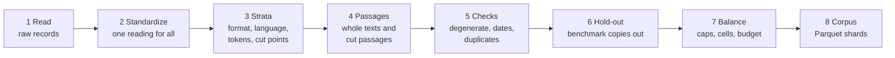

# 1. The data

[Front page](../TRAINING.md) · **1. Data** · [2. Splits](splits.md) · [3. Model](model.md) · [4. Training](training.md) ·
[5. Calibration](calibration.md) · [6. Experiments](experiments.md) · [7. Evaluation](evaluation.md) ·
[8. Engine](engine.md) · [9. Reproduce](reproduce.md)

Litmus learns from a **corpus**: a table of texts, each labeled human, AI, or mixed. The corpus is compiled from
public datasets only. Nothing in it was generated for Litmus, every source is pinned to an exact revision, and the
pipeline that compiles it is in this repository ([`corpus/`](../../corpus/README.md)). The compiled corpus itself is
kept as a private dataset because its rows carry their sources' many licenses; its recipe (the source table and the
code) is public.

- [The source table](#the-source-table)
- [How a row gets its label](#how-a-row-gets-its-label)
- [What kinds of sources](#what-kinds-of-sources)
- [The eight stages](#the-eight-stages)
- [Deduplication by content keys](#deduplication-by-content-keys)
- [What is held out, and why](#what-is-held-out-and-why)
- [Balance and the token budget](#balance-and-the-token-budget)
- [The released corpus in numbers](#the-released-corpus-in-numbers)
- [Benchmark families: trained on, and fully unseen](#benchmark-families-trained-on-and-fully-unseen)
- [Licenses](#licenses)
- [Where in the code](#where-in-the-code)

## The source table

The source table, [`corpus/sources.csv`](../../corpus/sources.csv), has one row per public dataset (one per
configuration of a dataset that has several). It is a list of instructions, not data: each row says where a dataset
is, which revision to read, which column holds the text, and how to label it. Its columns:

| Column | What it holds |
| --- | --- |
| `name`, `repo`, `config`, `split`, `revision` | Where the dataset is and the exact revision read; a GitHub or archive source names its files |
| `origin` | `human`, `ai`, or `mixed` when the whole source is one origin; `by_column` when a label column tells them apart |
| `text_column` | The column (or columns) holding the text |
| `label_column`, `label_map` | For `by_column` sources: the column, and the map from its values to human, AI, or mixed |
| `generator_column`, `generator` | Which model wrote a text: a column, or one fixed name for the whole source |
| `mix` | For mixed text: how it was mixed (polished, continued, paraphrased, edited by an expert, humanized, ...) |
| `date_column`, `date_evidence` | For human text: the column holding each text's date, or the evidence that the whole source predates 2022 |
| `domain`, `language`, `kind` | What the source holds: its domain, its language, and its kinds (prose, formatted, reasoning, long, code, multilingual, mixed, short) |
| `rows`, `bytes`, `license` | The size of the configuration and its declared license |
| `benchmark` | Set when the source is a benchmark or part of one (its training split, its test split) |
| `priority`, `verified`, `notes` | Which build reads it (1 is read first), what was checked against the Hub, and why |

Every row was checked against the Hugging Face Hub: its revision, declared license, and gating through the Hub API;
its row count and bytes, its columns, and the values of its label and generator columns through the datasets server.
`verified` records what held: `yes` (everything seen), `partial` (something unseen: a gated dataset, a loading
script, a partial row count; the reason is in the cell), or `no`. [`corpus/SOURCES.md`](../../corpus/SOURCES.md)
explains how the table was checked, what each kind of source covers, where public data is thin, and every source
considered and rejected.

The release was compiled from <!--litmus:record.corpus.sources_read-->220<!--/litmus--> sources.

## How a row gets its label

A row's origin comes from its source, never from a model's prediction:

1. **A one-origin source** (`origin` is `human`, `ai`, or `mixed`) labels every text with that origin.
2. **A labeled source** (`origin` is `by_column`) labels each text through `label_map`, for example
   `{"human_answers": "human", "chatgpt_answers": "ai"}`. A value outside the map stops the build for that source.
3. **Human text must be dated before 2022.** A human text with no date, or a date on or after 2022-01-01, is dropped
   (`human_undated`, `human_not_before_2022`). The date comes from `date_column` (for example a post's creation time),
   or from the source's own date for a corpus collected earlier (`date_evidence`).
4. **AI text names its generator** where the source says, from `generator_column` or `generator`.
5. **Mixed text names how it was mixed** where the source says, in `mix`.

Sources whose labels are themselves a detector's predictions are rejected, because a detector trained on another
detector's calls learns that detector ([`corpus/SOURCES.md`](../../corpus/SOURCES.md), Rejected).

## What kinds of sources

The table was built to fill the gaps of a prose-only predecessor corpus. Each kind below is a gap and the sources
that fill it ([`corpus/SOURCES.md`](../../corpus/SOURCES.md) names every source):

| Kind | Human side | Model side |
| --- | --- | --- |
| Raw, formatted model output | Reddit, Stack Overflow and Stack Exchange, GitHub issues, email, IRC, Hacker News, the Pile's subsets, all before 2022 | Chat logs (WildChat, LMSYS-Chat, the Arena sets) and response dumps of hundreds of models, kept with their markdown |
| Reasoning and scaffolding | None exists: thinking blocks are model-only by definition | Reasoning traces kept as written, `<think>` blocks included |
| Long text | Gutenberg, PG-19, arXiv full text, GovReport, BigPatent, BookSum, Pile of Law | LongWriter, deep-research reports, long stories, long answers |
| Code | CodeSearchNet, CodeNet, CodeContests, APPS, Stack Overflow, GitHub code, dated | CodeMirage, Magicoder, OpenCodeInstruct, and other named-generator sets |
| Non-English | mC4 with timestamps, Wiki-40B, Gutenberg in ten languages, XL-Sum, Europarl | Non-English chat turns, multilingual distillations, M4, and shared-task sets |
| Mixed | | LLMTrace, OpenTuringBench's revise and continue sets, paraphrase sets, humanizer sets, CoAuthor sentences, RAID's paraphrase attacks |
| Short | Titles, tweets, comments, short answers | Short chat replies, synthetic tweets, short sentences |

The release's build adds, beside these: the official training splits of benchmark families, RAID's training split
with every adversarial attack among them; the newest generators' sets; and more mixed-origin and human-domain data.
<!--litmus:record.corpus.sources_added-->
The release's build added 112 sources to the first build's; the largest are `raid_train` (599,989 rows), `h_amazon` (503,721), `h_yelp` (352,699), `h_wikiteam` (270,183), `gpt_writingprompts` (265,108) and `raid_extra_code` (244,947). Eight sources failed to read and are absent, among them both GitHub code sets, so human code is thin.
<!--/litmus-->

**Where public data stays thin** ([`corpus/SOURCES.md`](../../corpus/SOURCES.md)): long model-written text past about
8,000 tokens; human text in the assistant style (headings, bold lead-ins, tables in one reply), which has almost no
counterpart before 2022; mixed text, which is small against tens of millions of human and model texts; reasoning,
which has no human class at all, so a model learns that a thinking block means a model; and the newest generators,
whose public sets are mostly small. The balance below cannot create what the sources lack; it can only cut the larger
side.

## The eight stages

*The stages in the order they run. Hold-out runs before balance, so the balance the corpus reports is the balance it
ships.*

Each stage writes its own folder with a report of rows in and out by reason, and resumes from finished shards
([`corpus/README.md`](../../corpus/README.md)).

1. **Read.** Each source is read raw at its pinned revision, with the prompt each text answered where the source gives
   one. Formatting, code, and markup are kept.
2. **Standardize.** Every text, of every origin, gets the same standard reading, so no origin carries a trace of how
   it was stored. In order, each a replace-all:

   | Step | Rule |
   | --- | --- |
   | 1 | Unicode NFC normalization |
   | 2 | Line endings `\r\n` and `\r` to `\n` |
   | 3 | Delete control characters and invisible marks (U+0000 to U+0008, U+000B, U+000C, U+000E to U+001F, U+007F to U+009F, the soft hyphen, zero-width space, direction marks, the byte-order mark, and a few others); tab, newline, and the zero-width joiners stay |
   | 4 | Delete spaces and tabs before each newline and at the end |
   | 5 | Delete trailing whitespace at the end of the text |
   | 6 | Delete blank lines at the start |
   | 7 | At most two blank lines in a row |

   The exact character list is in [`student/SPEC.md`](../../student/SPEC.md), section 1, because the engine applies
   the same reading to your text. Then every trait that one origin carries and another does not (a source's
   boilerplate, a dataset's truncation marks, an export's escapes) is counted and removed.
3. **Strata.** Each text gets a **format** (`plain`, `markdown`, `list`, `table`, `code`, `math`, or `chat`), a
   **language** (fastText's `lid.176` model), a document hash, a **token count** with ModernBERT's tokenizer (the one
   the model reads with), and its **cut points** (sentence and line starts; line starts only in code and tables).
4. **Passages.** Each text gives itself as one row when it has at most 8,192 tokens, plus up to four passages cut
   from it. A passage starts and ends at cut points, so it never begins or ends inside a sentence of prose or a line
   of code. Each passage's target length $`t`$ is drawn evenly in the logarithm, with
   $`t = \lfloor \exp(u) \rfloor`$, $`u \sim \mathrm{Uniform}(\ln 8,\ \ln(t_{\max} + 1))`$, and
   $`t_{\max} = \min(8192,\ \lfloor n / 2 \rfloor)`$
   for a text of $`n`$ tokens (or $`t_{\max} = 8192`$ for a longer text), by a generator seeded with the text's hash,
   so both origins draw from one distribution at every length and a rerun cuts the same passages. Every row cut from
   a text keeps the text's document id (`doc`), so a split by document keeps a text and its passages together. A
   whole document of 8,193 to 131,072 tokens is kept only to evaluate the reading of long texts (`long_eval`) and is
   never trained on.

   *Worked example (made up).* A text of 3,000 tokens gives itself as a row, and $`t_{\max} = 1500`$. A draw of
   $`u = 5.0`$ gives a target of $`\lfloor e^{5.0} \rfloor = 148`$ tokens; the passage starts at a random cut point and
   ends at the cut point nearest 148 tokens later. A placement that lands under half or over twice the target, or
   overlaps a passage already placed, is tried again, three times at most.
5. **Checks.** Dropped: empty text; text with no letter, or one character repeated; looping text (1,000 bytes or more
   that compress below 8% of their size, or one line of ten or more characters making half or more of four or more
   lines); human text that is undated or dated 2022 or later; and duplicates (next section).
6. **Hold-out.** Copies of benchmark texts are removed ([below](#what-is-held-out-and-why)).
7. **Balance.** Caps per source, then human and AI text matched cell by cell, within a token budget
   ([below](#balance-and-the-token-budget)).
8. **Corpus.** Parquet shards with one row per text or passage, the source table, the report, and samples. A row
   holds `id`, `text`, `label` (0 human, 1 AI, 2 mixed), `source`, `generator`, `provider`, `era`, `domain`, `format`,
   `language`, `doc`, `tokens`, `whole`, `long_eval`, `mix`, `benchmark`, and two fields that link it to the
   predecessor corpus.

## Deduplication by content keys

A text that appears twice, or two texts that open the same way, would let the model memorize instead of learn, and
would let a copy of a test text slip into training. Every row therefore gets two **content keys**:

- the **text key**, a 64-bit BLAKE2b hash of the whole standardized text;
- the **opening key**, the same hash of the text's **opening**: its first 20 words, lowercased and joined by single
  spaces, at most 160 characters (so a text without spaces has an opening too).

Across the whole corpus:

1. **One row per key.** Among rows sharing a key, one is kept, with every row of its document (a whole text and a
   passage cut from its start share an opening by design, and are not copies). The kept row is the predecessor
   corpus's when it holds the key, else the first in a fixed seeded order, so no new source is preferred.
2. **A key under two origins is dropped from both.** If the same text, or the same opening, appears once as human and
   once as AI, neither label can be trusted, and both go.

*Worked example (made up).* Three rows open with the same 20 words, “the results of the survey show that most
respondents preferred the second option because it was cheaper and faster to”: a human forum post, an AI answer, and
a passage cut from the start of the same forum post. The two forum rows share a document, so they are one copy. The AI row shares the
opening under another origin, so all three rows are dropped (`opening_under_two_origins`).

## What is held out, and why

The benchmarks Litmus is compared on are listed in [`benchmarks/catalog.csv`](../../benchmarks/catalog.csv), each by
its exact repository, configuration, split, and revision. Their test texts must never reach training, or a
benchmark number would measure memory. Before balance:

- Every benchmark row is read too and kept apart as `benchmark`; it joins no set.
- A new training row that shares a **document**, a **text key**, or an **opening key** with any benchmark row is
  dropped (`benchmark_doc`, `benchmark_text`, `benchmark_opening`).
- A predecessor-corpus row that matches a benchmark row, or comes from a source the benchmark catalog holds out, is
  marked with the benchmark's name and leaves training.
- Rows of a benchmark whose labels are hidden (RAID's test split) hold their copies out the same way and are then
  dropped themselves.

A benchmark whose files the reader cannot open cannot be held out by content, so it leaves the comparison
([`benchmarks/README.md`](../../benchmarks/README.md)). <!--litmus:record.corpus.benchmarks_skipped-->This release skipped none: the second build read EditLens, HC3 and both AuTexTification sets, which the first build could not open, and held their texts out by content.<!--/litmus-->

For the corpus's own test split, the splits add a second, independent guard: whole clusters of similar texts go to
test, so a near-copy of a test text that the content keys miss still cannot be in training
([2. The splits](splits.md)). Benchmark rows are not clustered, so for a benchmark the content keys are the only
guard: a near-copy of a benchmark text that shares no document, text, or opening with it can still train.

## Balance and the token budget

A detector learns whatever separates its two classes, including accidents: if human texts were mostly short
Wikipedia prose and AI texts mostly long markdown answers, a model could learn “markdown means AI”. Balance removes
those shortcuts as far as the sources allow, in three cuts, each choosing rows by the hash of their text so a rerun
makes the same cut. Predecessor-corpus rows are counted but never cut, and benchmark rows are neither capped nor
balanced.

1. **Caps.** No one source dominates: a (source, generator) group of AI text keeps at most `ai_cap` rows
   (`legacy_ai_cap` for a generator of 2023 or earlier), a (source, domain) group of human text `human_cap`, and a
   (source, mix) group of mixed text `mixed_cap`.
2. **Cells.** Within each **cell** of (format, language group, length bin), the larger of human and AI text is cut
   to `balance_ratio` times the smaller, domain by domain toward the smaller class's domain counts, so the two
   classes match in format, language, length, and domain as far as the cell allows. A cell where one class is missing
   loses the other. Mixed text keeps at most as many rows in a cell as each class kept there. Length bins double from
   8 tokens: [8, 16), [16, 32), ..., [4,096, 8,192].
3. **Token budget.** New rows of each length bin may hold a fixed share of `new_token_budget` tokens. A bin over its
   share keeps the same fraction of every cell and origin in it, so the budget leaves the balance as it found it.

*Worked example (made up).* A cell (markdown, English, 256 to 511 tokens) holds 9,000 human and 40,000 AI rows after
the caps. With `balance_ratio` 1, AI is cut to 9,000, taking AI rows domain by domain toward the human rows' domain
counts. If the cell also holds 12,000 mixed rows, mixed keeps 9,000.

| Setting | Code default | The release build |
| --- | --- | --- |
| `ai_cap`, `legacy_ai_cap` | 150,000 and 40,000 rows | <!--litmus:record.corpus.caps_ai-->150,000 and 40,000 rows, the defaults<!--/litmus--> |
| `human_cap`, `mixed_cap` | 600,000 and 150,000 rows | <!--litmus:record.corpus.caps_human_mixed-->600,000 and 150,000 rows, the defaults<!--/litmus--> |
| `balance_ratio` | 1.0 | <!--litmus:record.corpus.balance_ratio-->1.0, the default<!--/litmus--> |
| `new_token_budget` | 3e9 tokens, a tenth per length bin | <!--litmus:record.corpus.new_token_budget-->2e9 tokens for the first build's rows and 1e9 for the rows the second build added<!--/litmus--> |
| `long_eval_cap` | 3,000 long documents per origin | <!--litmus:record.corpus.long_eval_cap-->3,000 long documents per origin, the default<!--/litmus--> |

## The released corpus in numbers

All counts are from the second build's `report.json` and corpus statistics.

| Measure | Human | AI | Mixed | All |
| --- | --- | --- | --- | --- |
| Rows | <!--litmus:record.corpus.rows.human as int-->7,138,302<!--/litmus--> | <!--litmus:record.corpus.rows.ai as int-->7,094,051<!--/litmus--> | <!--litmus:record.corpus.rows.mixed as int-->596,024<!--/litmus--> | <!--litmus:record.corpus.rows.all as int-->14,828,377<!--/litmus--> |
| Training tokens | <!--litmus:record.corpus.tokens.human as int-->1,735,273,783<!--/litmus--> | <!--litmus:record.corpus.tokens.ai as int-->1,745,846,763<!--/litmus--> | <!--litmus:record.corpus.tokens.mixed as int-->55,744,790<!--/litmus--> | <!--litmus:record.corpus.tokens.all as int-->3,536,865,336<!--/litmus--> |
| Long documents kept for evaluation | <!--litmus:record.corpus.long_documents.human as int-->4,445<!--/litmus--> | <!--litmus:record.corpus.long_documents.ai as int-->4,358<!--/litmus--> | <!--litmus:record.corpus.long_documents.mixed as int-->2<!--/litmus--> | <!--litmus:record.corpus.long_documents.all as int-->8,805<!--/litmus--> |
| Benchmark rows held apart | <!--litmus:record.corpus.benchmark_rows.human as int-->305,626<!--/litmus--> | <!--litmus:record.corpus.benchmark_rows.ai as int-->2,240,265<!--/litmus--> | <!--litmus:record.corpus.benchmark_rows.mixed as int-->32,255<!--/litmus--> | <!--litmus:record.corpus.benchmark_rows.all as int-->2,578,146<!--/litmus--> |

<!--litmus:record.corpus.composition-->
Rows and training tokens count every row not held apart as a benchmark: 14,828,377 of the corpus's 17,406,523, with tokens by ModernBERT's tokenizer. 12,653,367 rows are the first build's, kept with their ids, and 4,753,156 are the second build's (2,312,249 human, 2,123,640 AI and 269,265 mixed training rows, and 48,002 benchmark rows). Long documents are rows of 8,193 to 131,072 tokens marked `long_eval`, kept to evaluate the reading of a whole long text. 98.7% of these rows, and 98.8% of the training split's, are English.
<!--/litmus-->

<!--litmus:record.corpus.drops-->
The second build dropped 165,168 new rows that copied a first-corpus text and 91,223 that copied a first-corpus opening. RAID's training split was sampled by source document, half of its 13,371 source groups whole, and the AI cap per source and generator cut 1,217,078 more of its rows; its zero-width-space attack is not read and its synonym attack's human rows are dropped. Human rows of a source with no date are dropped by the date check, so `coling2025_multi`, `semeval2024_multi`, `dactyl_validation`, `rasbt_50k_train` and `defactify_train` hold AI text only, and eight sources failed to read and are absent, among them both GitHub code sets.
<!--/litmus-->

## Benchmark families: trained on, and fully unseen

The release trains on the official **training** splits of several benchmark families, while their **test** splits stay
held out by content. Those families are therefore *in distribution* for Litmus: their test texts are new, but texts
of the same kind, from the same generators and prompts, were trained on. Other benchmarks stay *fully unseen*: nothing
from them, train or test, is in the corpus. Every result table marks which is which.

| Benchmark | Training split in the corpus | Test or evaluation split |
| --- | --- | --- |
| RAID | Yes, with every adversarial attack | Hidden labels, scored only by the RAID leaderboard; this release has not been submitted to it |
| RAID extra: Python code | Yes: its code rows are training rows | Not scored |
| RAID extra: Czech and German news | No | Fully unseen |
| MAGE | Yes | Held out, in distribution |
| SemEval-2024 Task 8, subtask A | Yes | Held out, in distribution |
| DroidCollection | Yes: its training and development splits | Held out, in distribution |
| MAGE out-of-distribution sets (unseen domain and model; paraphrased) | No | Fully unseen |
| Beemo, MixSet, APT-Eval | No | Fully unseen |
| CoDET-M4 | No | Fully unseen |
| HC3, EditLens, AuTexTification (English and Spanish) | No | Fully unseen |

<!--litmus:record.corpus.training_families-->
The benchmark families' training splits hold 1,662,036 training rows, 11.2% of the corpus's: RAID 944,465 (210,941 human, 709,807 AI, 23,717 mixed), COLING 2025 232,147, SemEval-2024 116,464, DACTYL 112,200, Defactify 87,570, MAGE 82,540, CoAI 57,117, rasbt 50k 24,846 and Ghostbuster 4,687. DACTYL, Defactify and rasbt 50k hold AI text only, and COLING 2025 and SemEval-2024 nearly so, which risks a reading that keys on the source.
<!--/litmus-->

## Licenses

Every corpus row keeps its source's terms. Most sources declare a permissive license (Apache 2.0, MIT, CC BY), many
declare none, and a few constrain the compiled corpus most: CodeMirage is CC BY-NC-ND, and Pile of Law is
CC BY-NC-SA ([`corpus/SOURCES.md`](../../corpus/SOURCES.md), Notes). This is why the compiled corpus is not
redistributed, and why the reference bank in a release holds vectors and metadata, never text. The source table, the
pipeline, and the documentation are licensed as [`LICENSING.md`](../../LICENSING.md) states.

## Where in the code

| What | Function or file |
| --- | --- |
| The source table and its check | `corpus/sources.csv`; `litmus_corpus.catalog_check` |
| Standard reading | `litmus_corpus.standardize.standard_reading` (and `reference.standard_reading`, which the engine matches) |
| Passage lengths | `litmus_corpus.passages.passage_spans` |
| Degenerate text and dates | `litmus_corpus.checks.degenerate_reason`, `date_reason` |
| Content keys and duplicates | `litmus_corpus.checks.hash64`, `opening`, `duplicate_codes`, `global_duplicate_codes` |
| Benchmark hold-out | `litmus_corpus.holdout.holdout_decision` |
| Caps, balance, budget | `litmus_corpus.balance.cap_codes`, `balance_codes`, `budget_codes`, `long_eval_codes` |
| Build settings | `litmus_corpus.config.BuildConfig` |

---

Next: [2. The splits](splits.md)
