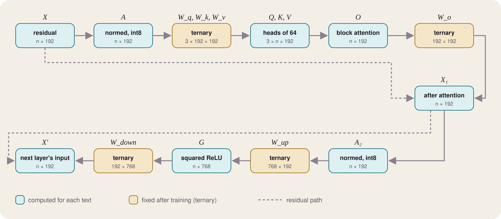
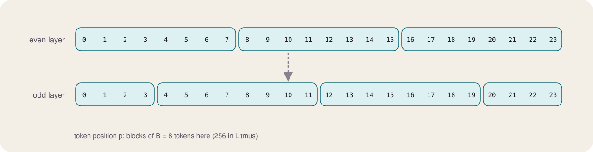
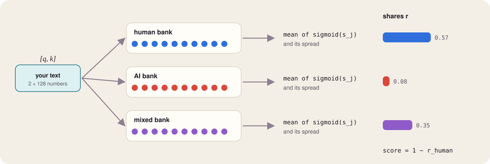
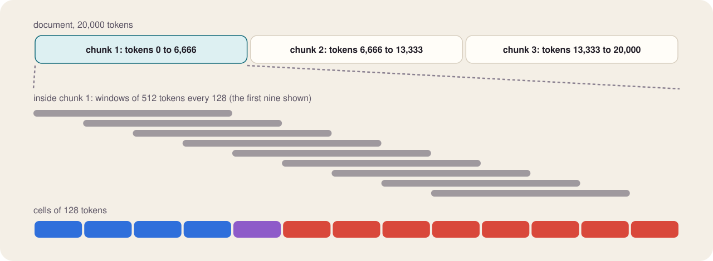

# 3. The model

[Front page](../TRAINING.md) · [1. Data](data.md) · [2. Splits](splits.md) · **3. Model** · [4. Training](training.md) ·
[5. Calibration](calibration.md) · [6. Experiments](experiments.md) · [7. Evaluation](evaluation.md) ·
[8. Engine](engine.md) · [9. Reproduce](reproduce.md)

The model is a fixed function: once trained, its weights never change, and the same text always gives the same
reading. It has three parts:

1. an **encoder** that turns a text's tokens into one vector per token, using weights that are each −1, 0, or +1;
2. a **head** that pools those vectors into one vector per text and maps it to a unit **query** and a unit **key**;
3. a **reference bank** of queries and keys of texts whose origin is known, against which a text is compared.

The contract that defines every operation below, to the bit where it matters, is
[`student/SPEC.md`](../../student/SPEC.md); [`student/reference.py`](../../student/reference.py) computes it in NumPy,
and the engine matches it. The PyTorch model that is trained is `student/src/litmus_student/model.py`.

- [Symbols](#symbols)
- [From text to token ids](#from-text-to-token-ids)
- [Ternary weights and 8-bit activations](#ternary-weights-and-8-bit-activations)
- [The token embedding](#the-token-embedding)
- [One encoder layer](#one-encoder-layer)
- [Attention inside shifted blocks](#attention-inside-shifted-blocks)
- [Pooling a text into one vector](#pooling-a-text-into-one-vector)
- [The head: a query and a key](#the-head-a-query-and-a-key)
- [The pair logit](#the-pair-logit)
- [The reference bank](#the-reference-bank)
- [Long texts: chunks, windows, and cells](#long-texts-chunks-windows-and-cells)
- [A forward pass worked by hand](#a-forward-pass-worked-by-hand)
- [Sizes](#sizes)
- [Where in the code](#where-in-the-code)

## Symbols

Real sizes are those of the smallest configuration, `s192_l4` ([`student/configs.json`](../../student/configs.json)).
The released configuration is <!--litmus:model.config_name-->s192_l4<!--/litmus-->.

| Symbol | What it is | Kind | Shape | `s192_l4` |
| --- | --- | --- | --- | --- |
| $`n`$ | Tokens in the text (or in one chunk of it) | count | | up to 8,192 |
| $`V`$ | Vocabulary size | constant | | 50,368 |
| $`e`$ | Embedding width | constant | | 128 |
| $`d`$ | Model width | constant | | 192 |
| $`L`$ | Layers | constant | | 4 |
| $`h`$, $`d_h`$ | Attention heads, and the width of one head, $`d_h = d / h`$ | constant | | 3, 64 |
| $`f`$ | Feed-forward width, $`4d`$ | constant | | 768 |
| $`B`$ | Attention block size (called `W` in the specification) | constant | | 256 |
| $`E`$ | Token embedding rows, int8 with one scale per row | fixed | $`V \times e`$ | 50,368 × 128 |
| $`W_{\mathrm{proj}}`$ | Embedding projection, ternary | fixed | $`d \times e`$ | 192 × 128 |
| $`W_q, W_k, W_v, W_o`$ | Attention weights of one layer, ternary | fixed | $`d \times d`$ each | 192 × 192 |
| $`W_{\mathrm{up}}`$, $`W_{\mathrm{down}}`$ | Feed-forward weights of one layer, ternary | fixed | $`f \times d`$, $`d \times f`$ | 768 × 192, 192 × 768 |
| $`g`$ | An RMS norm's gain | fixed | its input width | 192 or 768 |
| $`\gamma`$ | A ternary matrix's scale (one per matrix) | fixed | scalar | |
| $`X`$ | The residual stream, one row per token | computed | $`n \times d`$ | $`n`$ × 192 |
| $`H`$ | Token states after the last layer | computed | $`n \times d`$ | $`n`$ × 192 |
| $`x_{\mathrm{pool}}`$ | The text's pooled vector, mean and variance of $`H`$ | computed | $`2d`$ | 384 |
| $`W_1, W_2`$ | The head's two layers (float16) | fixed | $`d_{\mathrm{hid}} \times 2d`$, $`2w \times d_{\mathrm{hid}}`$ | 512 × 384, 256 × 512 in `configs.json`; release <!--litmus:t:head_widths-->hidden width 256, output width 64<!--/litmus--> |
| $`q, k`$ | The text's unit query and unit key | computed | $`w`$ each | 128 each in `configs.json`; release <!--litmus:config.head.out_width-->64<!--/litmus--> |
| $`a_s, b_s`$ | The pair logit's scale and bias | fixed | scalars | |
| $`N_o`$ | Bank texts of origin $`o`$ | count | | <!--litmus:t:bank_counts-->2,048 human, 2,048 AI, and 2,048 mixed<!--/litmus--> |

## From text to token ids

1. **Standard reading.** The text gets the same standard reading as every corpus text
   ([1. The data](data.md#the-eight-stages), stage 2), so a text pasted into the app is read the way training texts
   were.
2. **Tokens.** The tokenizer is ModernBERT's (`answerdotai/ModernBERT-large`'s `tokenizer.json`, pinned by revision
   and SHA-256): a byte-level byte-pair encoding with 50,368 entries, so no text is unreadable to it. No special token
   is added. A token is a word or a piece of one.

The result is a list of $`n`$ integers in $`[0, 50368)`$. A text of zero tokens has no reading.

## Ternary weights and 8-bit activations

These four operations are the arithmetic of every weight matrix in the encoder. They follow BitNet b1.58
([Ma et al., 2024](https://arxiv.org/abs/2402.17764)) and its training notes
([Training Tips, Code and FAQ](https://github.com/microsoft/unilm/blob/master/bitnet/The-Era-of-1-bit-LLMs__Training_Tips_Code_FAQ.pdf)).
*Round* is round half to even everywhere.

**A weight is not stored as a number but as one of three values.** During training each matrix keeps a float
**latent** matrix $`W`$ (outputs by inputs). Every forward pass replaces it by a ternary matrix and one scale:

```math
\gamma = \max\!\Big(\tfrac{1}{d_{\mathrm{out}} d_{\mathrm{in}}} \sum_{r,c} \lvert W_{rc} \rvert,\ 10^{-5}\Big), \qquad
T = \mathrm{clamp}\big(\mathrm{round}(W / \gamma),\ -1,\ 1\big)
```

so $`T_{rc} \in \{-1, 0, +1\}`$ and the weight the arithmetic uses is $`\gamma T`$. A weight smaller than half the mean
magnitude becomes 0. Only $`T`$ (2 bits a weight) and $`\gamma`$ are released; the latent matrix is discarded.

**An activation is stored as an 8-bit integer, with one scale per token.** For one token's input vector
$`x \in \mathbb{R}^{k}`$:

```math
m = \max\!\big(\max_i \lvert x_i \rvert,\ 10^{-5}\big), \qquad s = 127 / m, \qquad
\hat{x}_i = \mathrm{clamp}\big(\mathrm{round}(s\, x_i),\ -128,\ 127\big)
```

**The product is integer additions, then one multiply.** Each output is an exact integer sum, because every weight is
−1, 0, or +1, followed by a single rescale:

```math
\mathrm{acc}_r = \sum_{c} T_{rc}\, \hat{x}_c \in \mathbb{Z}, \qquad y_r = \mathrm{acc}_r \cdot \frac{\gamma}{s}
```

For all tokens at once, $`\mathrm{ACC} = \hat{X} T^{\top}`$ ($`n \times d_{\mathrm{out}}`$), and row $`i`$ is scaled by
$`\gamma / s_i`$. A weight of 0 skips its input; +1 adds it; −1 subtracts it.

**RMS norm.** Before every product the input is scaled to unit root mean square, with a learned gain per column:

```math
\mathrm{RMSNorm}(x)_i = \frac{x_i}{\sqrt{\tfrac{1}{k}\sum_{j} x_j^{2} + 10^{-6}}}\; g_i
```

**BitLinear** is the three in sequence: RMS norm, 8-bit quantization, ternary product. There are no biases anywhere in
the encoder.

*How it trains.* Rounding has no useful gradient, so training uses the **straight-through estimator**: the forward
pass uses the quantized values, and the backward pass treats quantization as if it were the identity, so the gradient
reaches the latent float weights and activations unchanged. In code, $`W + \mathrm{sg}(\gamma T - W)`$, where
$`\mathrm{sg}`$ stops the gradient. In evaluation mode the same modules compute the integer arithmetic above exactly.

### Worked example: one BitLinear product

Made-up numbers, computed with `reference.ternarize`, `rms_norm`, `quantize_activations`, and `ternary_product`. A
toy matrix of 2 outputs by 4 inputs, and one token with gain 1:

| Step | Values |
| --- | --- |
| Latent weights $`W`$ | row 1: 0.42, −0.05, −0.61, 0.18; row 2: −0.30, 0.77, 0.02, −0.26 |
| Scale $`\gamma`$ = mean of $`\lvert W \rvert`$ | 2.61 / 8 = 0.32625 |
| $`W / \gamma`$ | row 1: 1.29, −0.15, −1.87, 0.55; row 2: −0.92, 2.36, 0.06, −0.80 |
| Ternary $`T`$ (round, clamp) | row 1: +1, 0, −1, +1; row 2: −1, +1, 0, −1 |
| Stored codes $`T + 1`$, four per byte, low bits first | row 1: 2, 1, 0, 2 → byte 134; row 2: 0, 2, 1, 0 → byte 24 |
| Input $`x`$ | 0.9, −2.1, 0.3, 1.4 |
| RMS norm: $`x / \sqrt{1.8175}`$ | 0.6676, −1.5577, 0.2225, 1.0385 |
| Scale $`s = 127 / 1.5577`$ | 81.53 |
| Int8 $`\hat{x}`$ | 54, −127, 18, 85 |
| Integer sums | row 1: 54 − 18 + 85 = **121**; row 2: −54 − 127 − 85 = **−266** |
| Output $`y = \mathrm{acc} \cdot \gamma / s`$ | 121 × 0.004002 = **0.484**; −266 × 0.004002 = **−1.064** |

The same product with the float latent weights would give 0.410 and −1.665. The ternary layer is not an approximation
of a fixed float layer: training adjusts the latent weights until the ternary function is the one that works, which is
why the model is trained with quantization from the first step instead of quantized afterwards.

## The token embedding

Each token id selects one row of an int8 table with one float scale per row, and a BitLinear layer projects it from
width $`e`$ to width $`d`$:

```math
x^{(0)}_p = \mathrm{BitLinear}_{\mathrm{proj}}\big(E_{\mathrm{id}_p} \cdot \sigma_{\mathrm{id}_p}\big) \in \mathbb{R}^{d}
```

where $`\sigma_v = \max(\max_c \lvert E_{vc} \rvert, 10^{-5}) / 127`$ is row $`v`$'s scale. The factorized form (a narrow
table of width 128 and a projection) keeps the table, which is most of the file, small: 50,368 rows of 128 bytes is
6.6 MB, against 9.7 MB at width 192 and 19 MB at width 384. Stacking the $`n`$ rows gives $`X^{(0)}`$
($`n \times d`$), the start of the **residual stream**: the running sum that every layer adds to.

## One encoder layer

<picture>
  <source media="(prefers-color-scheme: dark)" srcset="../images/training/layer_dark.svg">
  
</picture>

*One layer at width 192. Teal boxes are computed for every text; ochre boxes are ternary weights, fixed after
training. The dashed lines are the residual path.*

For layer $`l = 0, \dots, L - 1`$, with $`X`$ its input ($`n \times d`$):

**Step 1, normalize and quantize once.** $`A = \mathrm{quant}(\mathrm{RMSNorm}(X; g_{\mathrm{attn}}))`$,
$`n \times d`$. Row $`i`$ is token $`i`$ as int8 with its scale.

**Step 2, queries, keys, and values.** Three ternary products of the same $`A`$:

```math
Q = A\, W_q^{\top}, \qquad K = A\, W_k^{\top}, \qquad V = A\, W_v^{\top} \qquad (n \times d \text{ each})
```

each split into $`h`$ heads of $`d_h`$ columns: $`Q`$ becomes $`n \times h \times d_h`$, and likewise $`K`$ and $`V`$.

**Step 3, rotary positions** on $`Q`$ and $`K`$ ([next section](#attention-inside-shifted-blocks)).

**Step 4, attention inside blocks,** gives $`O`$, $`n \times d`$ (heads concatenated).

**Step 5, back to the residual.** $`X_1 = X + \mathrm{BitLinear}_o(O)`$, with its own norm before $`W_o`$.

**Step 6, feed-forward with a squared ReLU** ([So et al., 2021](https://arxiv.org/abs/2109.08668)):

```math
U = \mathrm{BitLinear}_{\mathrm{up}}(X_1) \quad (n \times f), \qquad
G = \max(U, 0)^{2} \quad (n \times f), \qquad
X' = X_1 + \mathrm{BitLinear}_{\mathrm{down}}(G) \quad (n \times d)
```

The square is entry by entry. A negative entry of $`U`$ becomes exactly 0, which the engine exploits
([8. The engine](engine.md#skipping-zero-inputs)).

After the last layer, the **token states** are $`H = \mathrm{RMSNorm}(X^{(L)}; g_{\mathrm{final}})`$, $`n \times d`$:
row $`p`$ is token $`p`$'s final vector.

## Attention inside shifted blocks

**Attention** lets each token's vector take in information from other tokens: token $`i`$ scores every token $`j`$ it
may see by the dot product of its query with $`j`$'s key, turns the scores into weights that sum to 1, and takes the
weighted sum of their values. Full attention over a text of $`n`$ tokens costs $`n^2`$ scores per head and layer;
at 131,072 tokens that is $`1.7 \times 10^{10}`$ token pairs per head and layer, tens of minutes on one core. Litmus therefore attends only
**inside blocks** of $`B = 256`$ tokens, so the cost grows in proportion to the length.

<picture>
  <source media="(prefers-color-scheme: dark)" srcset="../images/training/blocks_dark.svg">
  
</picture>

*Blocks shift by half a block on odd layers, so tokens 7 and 8, apart on an even layer, share a block on the next.*

**Step 1, blocks.** On layer $`l`$ the shift is $`\delta_l = 0`$ for even $`l`$ and $`B/2`$ for odd $`l`$. Token
$`p`$ belongs to block $`\lfloor (p + \delta_l) / B \rfloor`$. On odd layers the first block holds tokens $`0`$ to
$`B/2 - 1`$, and the last block of a text holds whatever remains. Attention is two-way inside a block, and nothing
crosses a block. Because the blocks shift, information crosses every boundary within two layers, and a token's final
state depends on tokens up to $`L \cdot B`$ positions away (1,024 for `s192_l4`).

**Step 2, rotary positions** ([Su et al., 2021](https://arxiv.org/abs/2104.09864)) tell attention where tokens sit
inside their block. With $`r_p = (p + \delta_l) \bmod B`$ and, for $`j = 0, \dots, d_h/2 - 1`$,
$`\theta_j = r_p \cdot 10000^{-2j/d_h}`$, each head's query and key rotate their two halves:

```math
u'_j = u_j \cos\theta_j - u_{j + d_h/2} \sin\theta_j, \qquad
u'_{j + d_h/2} = u_{j + d_h/2} \cos\theta_j + u_j \sin\theta_j
```

**Step 3, scores, weights, and the weighted sum,** per head and block of $`n_b \le B`$ tokens:

```math
S = \frac{Q_b K_b^{\top}}{\sqrt{d_h}} \quad (n_b \times n_b), \qquad
P_{ij} = \frac{\exp(S_{ij} - \max_k S_{ik})}{\sum_{k} \exp(S_{ik} - \max_k S_{ik})}, \qquad
O_b = P\, V_b \quad (n_b \times d_h)
```

Row $`i`$ of $`P`$ is how much token $`i`$ takes from each token of its block. There is no padding and no global
token.

<details>
<summary>More detail: integer attention, an optional mode</summary>

A release may name integer attention ([`student/SPEC.md`](../../student/SPEC.md), Integer attention), which replaces
step 3 with integer products. Queries and keys become int8 with one scale per token ($`s_i = 127 / \max_c \lvert u_{ic}
\rvert`$), values int8 with one scale per block and head. The scores are exact integer dot products, scaled after the
sum; the softmax stays in float, computed by one fixed sequence of float32 operations so every implementation gets
the same bits; each weight is rounded to whole 127ths, $`p_{ij} = \mathrm{round}(127\, E_{ij} / \sum_k E_{ik})`$; and
the weighted sum of values is again an exact integer product. Trained in, it cost nothing measurable
([experiment E3](experiments.md#e3-integer-attention)). Whether the release uses it: <!--litmus:t:attention_use-->the release's `model.attention` is `integer`<!--/litmus-->.

</details>

## Pooling a text into one vector

The head needs one vector per text. Litmus takes the **mean and the variance** of the token states, side by side:

```math
\bar{h} = \frac{1}{n} \sum_{p} H_p, \qquad
\mathrm{var} = \frac{1}{n} \sum_{p} \big(H_p - \bar{h}\big)^{2}, \qquad
x_{\mathrm{pool}} = [\,\bar{h};\ \mathrm{var}\,] \in \mathbb{R}^{2d}
```

The variance says how much the text's tokens differ from one another, which the mean alone loses. The engine
computes both from running totals, $`T_p = \sum_{i \lt  p} H_i`$ and $`Q_p = \sum_{i \lt  p} H_i^{2}`$, kept in float64 in
token order, so the vector of any span $`[a, b)`$ of $`t = b - a`$ tokens is two subtractions away:

```math
\bar{h}_{[a,b)} = \frac{T_b - T_a}{t}, \qquad \mathrm{var}_{[a,b)} = \max\!\Big(\frac{Q_b - Q_a}{t} - \bar{h}_{[a,b)}^{2},\ 0\Big)
```

This is what makes the heat map's windows free: no second pass through the encoder
([below](#long-texts-chunks-windows-and-cells)). Whether pooling stays mean and variance in the release: <!--litmus:record.ablations.a3.outcome-->mean and variance (A3)<!--/litmus-->.

## The head: a query and a key

The head is a small float network (weights stored as float16) that maps the pooled vector to two unit vectors:

**Step 1, standardize and clamp.** Each of the $`2d`$ columns is standardized by statistics learned in training (the
variance columns are orders of magnitude smaller than the mean columns) and clamped at $`c`$ deviations:

```math
z = \mathrm{clamp}\!\Big(\frac{x_{\mathrm{pool}} - \mu_{\mathrm{in}}}{\sigma_{\mathrm{in}}},\ -c,\ c\Big) \in \mathbb{R}^{2d}
```

In training $`\mu_{\mathrm{in}}`$ and $`\sigma_{\mathrm{in}}`$ are the step's own column statistics, and running
averages of them (momentum 0.01) are what ships.

**Step 2, two layers with a SiLU between** ($`\mathrm{silu}(v) = v / (1 + e^{-v})`$):

```math
o = W_2\, \mathrm{silu}(W_1 z + b_1) + b_2 \in \mathbb{R}^{2w}
```

**Step 3, split and normalize.** $`q = o_{1:w} / \lVert o_{1:w} \rVert_2`$ and
$`k = o_{w+1:2w} / \lVert o_{w+1:2w} \rVert_2`$.

The query and the key are two views of the same text: in a comparison, one text's query meets the other's key.

<details>
<summary>More detail: int8 output, an optional mode</summary>

A release may name int8 output ([`student/SPEC.md`](../../student/SPEC.md), Int8 output), which replaces the division
by the norm in step 3 with a quantization. Each of $`o_{1:w}`$ and $`o_{w+1:2w}`$ becomes int8 with its own scale,
$`s = 127 / \max(\max_c \lvert x_c \rvert, \epsilon)`$ and $`\hat{x}_c = \mathrm{clamp}(\mathrm{round}(s\,x_c), -127,
127)`$, and the text's query and key are those codes, $`\hat{q}`$ and $`\hat{k}`$. The vectors the pair logit compares
are their unit vectors $`\hat{q} / \lVert \hat{q} \rVert`$ and $`\hat{k} / \lVert \hat{k} \rVert`$. In training the same
rounding sits in the forward pass with a straight-through gradient, so the loss sees the unit vectors of the codes the
release stores, not vectors that are rounded only afterwards. The bank is stored as the same codes, a bank text costing
$`2w + 17`$ bytes instead of $`4w + 17`$, and a comparison is four exact integer dot products per bank text ($`\hat{q}
\cdot \hat{q}_j`$, $`\hat{q} \cdot \hat{k}_j`$, $`\hat{k} \cdot \hat{q}_j`$, $`\hat{k} \cdot \hat{k}_j`$), each divided by
the two vectors' norms, which are square roots of integers. Whether the release uses it: <!--litmus:t:output_use-->the release's `model.output` is `int8`<!--/litmus-->.

</details>

| Setting | `configs.json` | Release |
| --- | --- | --- |
| Hidden width $`d_{\mathrm{hid}}`$ | 512 | <!--litmus:config.head.hidden-->256<!--/litmus--> |
| Query and key width $`w`$ | 128 | <!--litmus:config.head.out_width-->64<!--/litmus--> |
| Clamp $`c`$ | 10 | <!--litmus:config.head.clamp as f0-->30<!--/litmus--> |

## The pair logit

Two texts $`a`$ and $`b`$ are compared by one number, the **pair logit**, the model's log-odds that they share an
origin:

```math
s(a, b) = a_s \cdot \frac{q_a^{\top} k_b + q_b^{\top} k_a}{2} + b_s
```

with a learned scale $`a_s \in [1, 100]`$ (it starts at 10) and a learned bias $`b_s`$. It is the same whichever text
comes first, and it is one inner product of stored vectors, so a text is compared with thousands of reference texts in
milliseconds. Its sigmoid, $`\sigma(s) = 1 / (1 + e^{-s})`$, is the probability that the two share an origin: human with
human, AI with AI, mixed with mixed. Using a query and a key instead of one vector lets a text score itself low, which
a plain cosine cannot.

## The reference bank

<picture>
  <source media="(prefers-color-scheme: dark)" srcset="../images/training/bank_dark.svg">
  
</picture>

*A reading is a comparison with known texts. The shares shown are the worked example's.*

Litmus does not ask the model “is this AI?” outright. It compares the text with a **bank** of reference texts of known
origin, stored as their unit queries and keys (float16, $`N \times 2w`$, grouped human, AI, mixed; int8 codes in the
int8 mode above) with each one's token count and metadata (source, generator, domain, era, format, language), never its text. For bank text $`j`$:

```math
s_j = s(\text{text}, j), \qquad p_j = \sigma(s_j)
```

Per origin $`o`$, over its $`N_o`$ bank texts, the **mean** and the **spread** of those probabilities, and then the
**shares**:

```math
m_o = \frac{1}{N_o} \sum_{j \in o} p_j, \qquad
\mathrm{sd}_o = \sqrt{\frac{1}{N_o} \sum_{j \in o} (p_j - m_o)^{2}}, \qquad
r_o = \frac{m_o}{m_{\mathrm{human}} + m_{\mathrm{AI}} + m_{\mathrm{mixed}}}, \qquad
\mathrm{score} = 1 - r_{\mathrm{human}}
```

and the **closeness**: the mean of the 16 highest cosines between the text's $`[q; k]`$ and any bank row. These five
kinds of numbers (mean, spread, share, score, closeness) and the token count are everything calibration reads
([5. Calibration](calibration.md)). The bank of the release holds <!--litmus:t:bank_counts-->2,048 human, 2,048 AI, and 2,048 mixed<!--/litmus--> texts, drawn <!--litmus:record.model.bank_variant-->from training rows for human and AI text and from 4,096 reserved mixed rows that never trained, 2,048 an origin (the `mixed_out` recipe)<!--/litmus-->.

*Worked example (made up).* A bank of two texts per origin and one text
whose pair logits against them are 2.0 and 1.0 (human), −3.0 and −1.5 (AI), −0.5 and 0.5 (mixed):

| | Human bank | AI bank | Mixed bank |
| --- | --- | --- | --- |
| $`p_j = \sigma(s_j)`$ | 0.881, 0.731 | 0.047, 0.182 | 0.378, 0.622 |
| Mean $`m_o`$ | 0.806 | 0.115 | 0.500 |
| Spread $`\mathrm{sd}_o`$ | 0.075 | 0.068 | 0.122 |
| Share $`r_o`$ | **0.567** | 0.081 | 0.352 |

The score is $`1 - 0.567 = 0.433`$. This text reads mostly human, partly mixed, and hardly AI; how sure that is depends
on how calibration texts of its length score ([5. Calibration](calibration.md)).

## Long texts: chunks, windows, and cells

<picture>
  <source media="(prefers-color-scheme: dark)" srcset="../images/training/chunks_dark.svg">
  
</picture>

*Chunks decide the verdict; windows and cells draw the heat map. The cell colors are made up.*

- **Chunks.** A text of $`n`$ tokens is cut into $`C = \lceil n / 8192 \rceil`$ chunks; chunk $`c`$ holds positions
  $`\lfloor c\,n / C \rfloor`$ to $`\lfloor (c+1)\,n / C \rfloor`$, so chunks differ in length by at most one token.
  Each chunk is read as a text of its own, from a fresh encoder state, exactly as a training text of that length is
  read. 8,192 tokens is the longest training text, so every chunk is a kind of input the model learned from. The
  document's verdict combines its chunks' calibrated readings
  ([5. Calibration](calibration.md#long-documents-combining-chunks)). *Example:* 20,000 tokens give $`C = 3`$
  chunks, tokens 0 to 6,666, 6,666 to 13,333, and 13,333 to 20,000.
- **Windows.** Inside a chunk of $`m`$ tokens, windows of 512 tokens start every 128 tokens, plus one ending at the
  chunk's end if the last does not; a chunk of 8,192 tokens has 61 windows, and a chunk of 1,000 tokens has five
  (starting at 0, 128, 256, 384, and 488). Each window's vector comes from the running totals and is read through the
  head, the bank, and calibration as a text of its own length.
- **Cells.** The heat map has one cell per 128 tokens. A cell's position on the strip is the mean of the positions of
  the windows over it, weighted by how many of the cell's tokens each window holds; its band spans those windows'
  bands.

A window's tokens were computed with neighbors outside the window in view (attention reaches $`L \cdot B`$ positions),
so its reading is close to, not the same as, the reading of those words alone; the evaluation measures the gap
([7. Evaluation](evaluation.md)). The heat map shows where to look; the verdict comes from the chunks, never from the
most extreme window.

## A forward pass worked by hand

Made-up numbers on toy sizes, each stage computed with the reference functions named in
[Where in the code](#where-in-the-code).

1. **Quantize and multiply.** One token through one BitLinear layer of 2 outputs by 4 inputs, as worked
   [above](#worked-example-one-bitlinear-product): int8 input (54, −127, 18, 85), ternary rows (+1, 0, −1, +1) and
   (−1, +1, 0, −1), integer sums 121 and −266, outputs 0.484 and −1.064.
2. **Pool.** Three token states of width 2 after the last layer:

   | Token | State |
   | --- | --- |
   | 1 | 1.0, −0.5 |
   | 2 | 0.4, 0.3 |
   | 3 | −0.2, 0.8 |
   | Mean $`\bar{h}`$ | 0.4, 0.2 |
   | Variance | 0.24, 0.287 |

   The pooled vector is $`x_{\mathrm{pool}} = (0.4, 0.2, 0.24, 0.287)`$, width $`2d = 4`$. From running totals,
   $`T_3 = (1.2, 0.6)`$ and $`Q_3 = (1.2, 0.98)`$: $`1.2 / 3 = 0.4`$, and $`0.98 / 3 - 0.2^2 = 0.287`$, the same.
3. **Head.** The head maps the pooled vector to a unit query and key; with toy values $`q = (0.981, 0.196)`$ and
   $`k = (0.992, -0.124)`$.
4. **Compare.** Against bank texts, the pair logits become probabilities, means per origin, and the shares
   0.567, 0.081, and 0.352 of [the bank example](#the-reference-bank); calibration then turns those into the
   verdict.

## Sizes

The sizes the encoder comes in ([`student/SPEC.md`](../../student/SPEC.md), Sizes; all with $`e = 128`$, $`B = 256`$,
$`f = 4d`$, heads of 64). **Ternary weights** count every ternary matrix, the embedding's projection included. The
measured speed is the engine's on one core of an AMD Ryzen 7 3800X (AVX2), from text to full reading at 8,192 tokens,
on releases with random weights ([`engine/README.md`](../../engine/README.md), Measurements).

| Config | $`d`$ | $`L`$ | Ternary weights | Model file without the bank | Tokens a second, one core |
| --- | --- | --- | --- | --- | --- |
| `s192_l4` | 192 | 4 | 1.79M | 7.8 MB | 21,926 |
| `s192_l6` | 192 | 6 | 2.68M | 8.0 MB | 15,231 |
| `s256_l6` | 256 | 6 | 4.75M | 8.7 MB | 10,034 |
| `s384_l8` | 384 | 8 | 14.20M | 11.3 MB | 4,214 |
| `s512_l12` | 512 | 12 | 37.81M | 17.6 MB | <!--litmus:record.sizes.s512_l12_tokens_per_second as int-->1,870<!--/litmus--> |

The release is <!--litmus:t:released_config-->`s192_l4`, with release files of 10.8 MB including its bank, reading 28,022 tokens a second on one core<!--/litmus-->.

## Where in the code

| Formula | Reference (NumPy, `student/reference.py`) | Training (PyTorch, `litmus_student.model`) |
| --- | --- | --- |
| Absmean ternary $`\gamma, T`$ | `ternarize` | `TernaryLinear.ternary` |
| 2-bit packing | `pack_ternary`, `unpack_ternary` | `litmus_student.export.ternary_tensors` |
| Absmax int8 $`s, \hat{x}`$ | `quantize_activations` | `quantize_activations` |
| Ternary product $`\mathrm{acc} \cdot \gamma / s`$ | `ternary_product` | `TernaryLinear.forward` (eval mode) |
| RMS norm | `rms_norm` | `RMSNorm.forward` |
| Straight-through gradient | | `straight_through` |
| Embedding rows and scales | `quantize_embedding` | `QuantizedEmbedding` |
| Rotary tables and rotation | `rope_tables`, `apply_rope` | `apply_rope` |
| Blocks and their mask | `ReferenceModel` | `block_mask`, `Layer.forward` |
| Integer attention | `integer_attention`, `exp_nonpositive` | `integer_block_attention`, `integer_block_attention_eval` |
| Squared ReLU feed-forward | `ReferenceModel` | `Layer.forward` |
| Pooling, from running totals | `pooled_statistics`, `ChunkPool` | `pool` |
| Head: standardize, clamp, SiLU, normalize | `ReferenceModel` | `StudentHead.standardize`, `StudentHead.project` |
| Int8 output: codes and unit vectors | `quantize_output`, `ReferenceModel.unit_vectors` | `StudentHead` with `int8_output` |
| Pair logit | `ReferenceModel` | `litmus_student.distill.pair_logits` |
| Bank mean, spread, shares, closeness | `ReferenceModel` | `litmus_student.train.bank_coverage`, `bank_shares` |
| Chunks, windows, cells | `chunk_bounds`, `window_spans`, `cell_spans`, `heat_map` | |
| Size table | | `estimated_cost` (`python -m litmus_student.model`) |

---

Previous: [2. The splits](splits.md) · Next: [4. Training](training.md)
