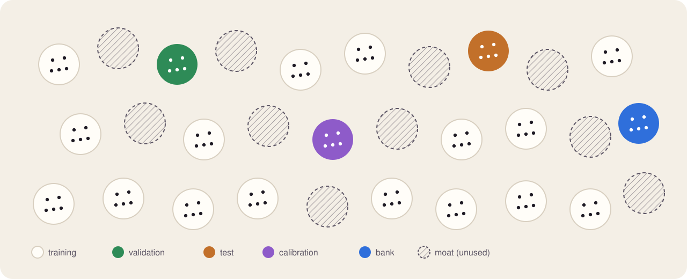

# 2. The splits

[Front page](../TRAINING.md) · [1. Data](data.md) · **2. Splits** · [3. Model](model.md) · [4. Training](training.md) ·
[5. Calibration](calibration.md) · [6. Experiments](experiments.md) · [7. Evaluation](evaluation.md) ·
[8. Engine](engine.md) · [9. Reproduce](reproduce.md)

The corpus is cut into five sets, each with one job:

| Set | Job | Read |
| --- | --- | --- |
| **train** | The texts the model learns from | Every step |
| **validation** | Chooses the checkpoint, the settings, and the bank | At every evaluation |
| **test** | Measures the released model | Once, after everything is chosen |
| **calibration** | Turns raw scores into p-values and probabilities ([5. Calibration](calibration.md)) | When the release is exported |
| **bank** or **bank draw** | The reference texts a reading compares against, or rows reserved for them ([3. The model](model.md#the-reference-bank)) | When the release is exported |

The release build has no bank set of held-out clusters: its fifth set is a bank draw of mixed rows reserved for the
bank, and the bank's human and AI texts are training rows ([the banks](#step-3-give-whole-clusters-to-sets-with-moats)).

A random split would be wrong for text. The corpus holds near-copies: the same news story rewritten by two models,
the same prompt answered a hundred times, a passage and the text it was cut from. A random split puts one copy in
training and the other in test, and the test then measures memory. Litmus therefore splits by **clusters of similar
texts**, gives each cluster whole to one set, and leaves the clusters that sit between two sets unused, as a **moat**.

- [Step 1: embed every text with a frozen encoder](#step-1-embed-every-text-with-a-frozen-encoder)
- [Step 2: cluster with e-means](#step-2-cluster-with-e-means)
- [Step 3: give whole clusters to sets, with moats](#step-3-give-whole-clusters-to-sets-with-moats)
- [Step 4: from clusters to rows](#step-4-from-clusters-to-rows)
- [A toy split, worked by hand](#a-toy-split-worked-by-hand)
- [Why near-duplicates cannot cross](#why-near-duplicates-cannot-cross)
- [The released splits in numbers](#the-released-splits-in-numbers)
- [Where in the code](#where-in-the-code)

## Step 1: embed every text with a frozen encoder

An **encoder** is a neural network that turns a text into one vector of numbers, so that texts with similar content
and style get nearby vectors. Litmus uses **ModernBERT-base** ([Warner et al., 2024](https://arxiv.org/abs/2412.13663);
`answerdotai/ModernBERT-base`, 768 wide, pinned revision `8949b90`) **frozen**: its weights are never changed, it is
only read. It reads a text as `[CLS]` text `[SEP]` and gives one 768-number **state** per token from its last layer.

A text's **embedding** is the mean and the variance of those states, side by side:

```math
\mu = \frac{1}{t} \sum_{p=1}^{t} h_p, \qquad v = \frac{1}{t} \sum_{p=1}^{t} (h_p - \mu)^{2}, \qquad e = [\,\mu;\ v\,] \in \mathbb{R}^{1536}
```

where $`h_p`$ is the state of token $`p`$, $`t`$ the number of tokens, and the square is taken entry by entry. A text
longer than the encoder's context is embedded in windows whose sums, sums of squares, and counts combine exactly into
the same $`\mu`$ and $`v`$. Every corpus row, all origins and all sets, is embedded once and stored as float16.

<details>
<summary>More detail: reusing the predecessor corpus's stored vectors</summary>

A row whose text is byte for byte the same as a row of the predecessor corpus, and whose length is within that
corpus's 4,096-token cap, may copy its stored ModernBERT-base vector instead of being embedded again. A pilot
recomputes 2,000 such rows and compares them with the stored vectors by three rules, because reused rows hold no mixed
text and any difference would be correlated with origin:

1. **Shift.** A linear reader tells stored from recomputed vectors at a held-out ROC AUC above 0.6.
2. **Spread.** The same reader on squared standardized columns does the same (this catches a changed scale that an
   affine alignment would hide from rule 1).
3. **Noise.** The 99th percentile of the paired $`1 - \cos`$ exceeds twice the noise between two of our own bfloat16
   packings.

If none fires, the stored vectors are copied as stored (`safe`); if they fire but a per-column affine map fitted on
half the pairs makes the other half pass, they are copied through that map (`aligned`); otherwise every row is
computed (`refused`). For the release build: <!--litmus:record.split.reuse_outcome-->9,835,199 rows whose text was unchanged took the first corpus's stored vectors as stored (the same encoder, revision and settings, so no check fired) and 5,003,766 were computed<!--/litmus-->. Details in [`teacher/README.md`](../../teacher/README.md).

</details>

| Symbol | What it is | Kind | Shape | Real size |
| --- | --- | --- | --- | --- |
| $`h_p`$ | The frozen encoder's last-layer state of token $`p`$ | computed | $`D`$ | 768 |
| $`\mu`$, $`v`$ | Mean and variance of a text's states | computed | $`D`$ each | 768 each |
| $`e`$ | The text's embedding, $`[\mu; v]`$ | computed | $`2D`$ | 1,536 |
| $`c`$ | The mean of $`\mu`$ over all eligible rows | computed once | $`D`$ | 768 |
| $`f_i`$ | Row $`i`$'s clustering feature, unit length | computed once | $`D`$ | 768 |
| $`m`$ | Eligible rows (not benchmark, embedded) | count | | <!--litmus:record.split.eligible_rows as int-->14,828,377<!--/litmus--> |
| $`r`$ | Rows a cluster the split aims for | setting | | 2,500 by default; `--rows-per-cluster 1000` in the release build |
| $`k`$ | Number of clusters, $`\max(16, \mathrm{round}(m / r))`$ | count | | <!--litmus:record.split.clusters as int-->14,828<!--/litmus--> |
| $`z_j`$ | Centroid of cluster $`j`$, unit length | computed once | $`D`$ | 768 |

## Step 2: cluster with e-means

Only the mean half is clustered. It is centered on the mean over all eligible rows and scaled to unit length, so that
the dot product of two features is their cosine similarity:

```math
f_i = \frac{\mu_i - c}{\lVert \mu_i - c \rVert_2}, \qquad c = \frac{1}{m} \sum_{i=1}^{m} \mu_i
```

**e-means** ([Bessa et al., 2026](https://arxiv.org/abs/2611.09501)) is a mini-batch successor of k-means: it finds
$`k`$ centroids $`z_1, \dots, z_k`$ such that each feature is close to its nearest centroid, updating the centroids by
an exponential moving average over mini-batches instead of full passes. Litmus runs its spherical form (centroids kept
on the unit sphere, so the nearest centroid is the one of highest cosine) through the FAISS reference implementation,
for 5 epochs, with

```math
k = \max\!\big(16,\ \mathrm{round}(m / r)\big),
```

about $`r`$ rows a cluster ($`r`$ = 2,500 by default; the release build set `--rows-per-cluster 1000`). The final
cluster of each row comes from one assignment pass against the final centroids,

```math
\mathrm{cluster}(i) = \arg\max_{j} \, f_i^{\top} z_j .
```

A cluster of one to a few thousand texts is a region of similar texts: one source's answers to one kind of prompt, one forum's posts
on one subject, one model's stories in one genre.

## Step 3: give whole clusters to sets, with moats

<picture>
  <source media="(prefers-color-scheme: dark)" srcset="../images/training/split_dark.svg">
  
</picture>

*Whole clusters go to sets. Every held-out cluster is surrounded by its moat: its nearest clusters, left unused, so
no training cluster touches it. A toy layout; a real split has thousands of clusters.*

Each cluster's **neighbors** are its two nearest clusters by centroid cosine, $`\arg\max_{j \neq c} z_c^{\top} z_j`$
taken twice, plus every cluster that counts it among its own two nearest (so the relation is symmetric). Clusters are
then given to the four held-out sets (test, calibration, validation, bank) greedily, one cluster per round:

1. **Which set picks.** Each set has a target number of rows per origin (times 1.25, since later cuts remove rows;
   the mixed target is a quarter of the others, as mixed text is scarce). The set furthest below its targets picks.
2. **Which clusters it may pick.** A free cluster, or a moat cluster of this set only, whose neighbors belong to no
   other held-out set.
3. **How it scores them.** A candidate's **gain** is the share of the set's remaining target it fills, counting at
   most 500 rows per origin from one cluster. Its **novelty** is the share of its rows in (format, language) cells the
   set still lacks (fewer than 200 rows). Its cost is how many free clusters picking it would turn into moat:

   ```math
   \mathrm{score} = \frac{\mathrm{gain} \times (1 + 0.5 \times \mathrm{novelty})}{1 + \mathrm{newly\ moated}}
   ```

4. **The pick.** One of the eight best scores, at random (seeded), so the sets do not all draw from one corner.
5. **The moat.** Every neighbor of the picked cluster that is still free becomes moat, owned by this set.

When no set can gain more, the rounds stop. Every cluster never picked and never moated is a **training cluster**.

**The release build's split.** From 1.1 there are **five sets**, disjoint by cluster: training, validation, test,
calibration and the reference set (the bank), so the texts a reading compares against never trained and share no
cluster with any other set (Logan, 2026-11-19: "Reference and calibration are exceedingly diverse. All 5 need to be
disjoint"). It set a low cap per held-out cluster and origin (`--cap 50`, against 500 by default, in both the gain and
the trim of step 4), so each held-out set draws from many clusters; let mixed text fill the held-out targets like the
other origins (`--mixed-share 1.0`); kept every document in one cluster (`--keep-docs-together`); and gave the bank a
target of 9,300 rows an origin, so that 8,192 of each exist once the export's filters run. Only English and
undetermined-language rows could enter a held-out set or the bank (`--held-out-languages en und`): a row of
another language trains, unless its cluster is held out or moat or its document has a row in a held-out set, and then
it is unused. Training's human and AI text was then cut, language by language, so that the larger
is at most 1.5 times the smaller (`--train-language-ratio 1.5`). Every argument is in [9. Reproduce it](reproduce.md#the-commands-in-order).

<details>
<summary>More detail: the banks</summary>

The bank can be built three ways:

- **(a) held-out clusters**: the bank set above, clusters no training text shares;
- **(b) a stratified draw** (`bank_draw`): an equal share of rows per origin from every training cluster, from
  documents no held-out set holds, so the bank covers every region of the corpus;
- **(c) `mixed_out`**: the human and AI bank texts drawn uniformly from training rows when the release is exported,
  so the model has trained on them, and the mixed texts from a bank draw of mixed rows alone
  (`--bank-draw-origins mixed`), which never train. Litmus 1.0.0's bank.
- **(d) `reference`**: all three origins from the held-out bank set (a), 8,192 texts an origin, the first in a seeded
  order; Litmus 1.1's bank.

Rows in the bank draw leave training with their whole documents. Validation chose (b) over (a) for the teacher's bank
([experiment E9](experiments.md#e9-bank-held-out-clusters-or-a-draw-from-training-clusters)); 1.1 takes (a), as the
maintainer asked, so no reading compares a text with one the model trained on. The release's bank is
drawn <!--litmus:record.model.bank_variant-->the withheld reference set, 8,192 texts an origin from clusters no other set holds and that never trained (the `reference` recipe), embedded again at every validation reading and by the export<!--/litmus-->.

</details>

## Step 4: from clusters to rows

The cluster assignment fixes each row's set, and four rules then trim the rows, in this order:

1. **Documents stay on one side.** A document with rows in several held-out sets stays only in the first of test,
   calibration, validation, bank; its other rows become unused.
2. **No cluster dominates a set.** A held-out cluster keeps at most 500 rows per origin, taken round-robin over
   length bins, so its short and long texts both survive.
3. **Held-out sets are balanced by length.** In each length bin, human and AI rows are cut to the smaller of the two,
   taken round-robin over format and language; a bin keeps at most as many mixed rows as human ones, and a set at most
   25% of its per-origin target in mixed rows. Mixed text is scarce and mostly short, so balancing all three origins
   per bin would leave the held-out sets no long text.
4. **Training loses every document a held-out set touches.** A training row whose document has a row in any held-out
   set, or in the bank draw, becomes unused. Benchmark rows are never eligible.

Then the split is checked, and the build fails if any check fails: no two sets share a cluster; no two sets share a
document; no moat cluster kept a row; every held-out cluster's neighbors are its own set's or unused; and in every
length bin of every held-out set the human and AI counts are equal and mixed is at most human. A distance report
records, for a sample of each set, the median cosine of each row to its nearest training row of another document.

| Set | Target rows per origin (code default) | The release, rows built |
| --- | --- | --- |
| test | 20,000 | <!--litmus:record.split.built.test as int-->57,991<!--/litmus--> |
| calibration | 30,000 | <!--litmus:record.split.built.calibration as int-->58,012<!--/litmus--> |
| validation | 10,000 | <!--litmus:record.split.built.validation as int-->28,990<!--/litmus--> |
| bank (held-out clusters; none in the release build) | 16,384 | <!--litmus:record.split.built.bank_heldout as int-->26,892<!--/litmus--> |
| bank draw (from training clusters; mixed rows only in the release build) | 16,384 | <!--litmus:record.split.built.bank_draw as int-->0<!--/litmus--> |

## A toy split, worked by hand

Made-up numbers. Twelve clusters lie on a ring, $`C_1`$ to $`C_{12}`$, each nearest to the clusters beside it, so
each cluster's neighbors are the two adjacent ones. Validation is furthest from its target and picks first.

Assume every cluster would fill the same share of a target (equal gain) and none adds novelty, so the score differs
only by how many free clusters a pick would moat.

| Round | Set | Candidates | Pick | Becomes moat |
| --- | --- | --- | --- | --- |
| 1 | validation | All twelve; each would moat two | $`C_3`$, drawn among the eight best | $`C_2`$, $`C_4`$ |
| 2 | test | $`C_1`$ and $`C_5`$ to $`C_{12}`$ ($`C_2`$ and $`C_4`$ are validation's moat). $`C_1`$ and $`C_5`$ would moat one new cluster each, score $`1/2`$; the rest two, score $`1/3`$ | $`C_5`$ | $`C_6`$ ($`C_4`$ is moat already) |
| 3 | calibration | $`C_1`$, $`C_7`$ to $`C_{12}`$ | $`C_9`$, drawn among the eight best | $`C_8`$, $`C_{10}`$ |

After three rounds: validation $`\{C_3\}`$, test $`\{C_5\}`$, calibration $`\{C_9\}`$, moat
$`\{C_2, C_4, C_6, C_8, C_{10}\}`$, training $`\{C_1, C_7, C_{11}, C_{12}\}`$. No training cluster is adjacent to a
held-out cluster, and no two held-out clusters are adjacent.

Then the rows of validation's cluster $`C_3`$: say it holds 700 human, 900 AI, and 40 mixed rows. The cap keeps 500
human and 500 AI (round-robin over length bins) and all 40 mixed. If one length bin then holds 120 human and 90 AI
rows, balance cuts human to 90 in that bin; that bin keeps at most 90 mixed rows. Finally, if a forum thread has one
post in $`C_3`$ and another in $`C_1`$, the post in training cluster $`C_1`$ becomes unused.

## Why near-duplicates cannot cross

Three independent guards keep a copy of a held-out text out of training:

1. **Content keys** ([1. The data](data.md#deduplication-by-content-keys)) remove exact copies and texts that open
   with the same 20 words, across all origins and sources.
2. **Documents** never span two sets, so a passage and the text it was cut from stay together.
3. **Clusters and moats.** A near-copy that differs in wording has an embedding close to the original's, so it falls
   in the same cluster, which goes whole to one set, or in a neighboring cluster, which is a moat.

The third guard is a geometric argument, not a proof: two texts that a reader would call near-copies but whose
embeddings are far apart could still land in a training cluster and a test cluster. The distance report measures how
close held-out rows sit to training: <!--litmus:record.split.distance_report-->the median cosine distance from a held-out row to its nearest training row is 0.769 for test, 0.767 for calibration, 0.773 for validation and 0.766 for the reference set, against 0.763 from a training row to its nearest other training row (4,000 rows a set; tenth percentiles 0.639, 0.632, 0.634, 0.630 and 0.628): with a cap of 50 rows a cluster the held-out sets draw from about twice as many clusters as 1.0.0's and sit about as far from training as training rows sit from each other<!--/litmus-->.

**Benchmark test content** is kept out twice over: benchmark rows are never eligible for any set, and every training
row that shares a document, a text, or an opening with a benchmark row was dropped before the split
([1. The data](data.md#what-is-held-out-and-why)).

## The released splits in numbers

| Set | Clusters | Human | AI | Mixed | Rows |
| --- | --- | --- | --- | --- | --- |
| train | <!--litmus:record.splits.rows[set=train].clusters as int-->11,337<!--/litmus--> | <!--litmus:record.splits.rows[set=train].human as int-->5,900,740<!--/litmus--> | <!--litmus:record.splits.rows[set=train].ai as int-->5,077,061<!--/litmus--> | <!--litmus:record.splits.rows[set=train].mixed as int-->153,889<!--/litmus--> | <!--litmus:record.splits.rows[set=train].rows as int-->11,131,690<!--/litmus--> |
| validation | <!--litmus:record.splits.rows[set=validation].clusters as int-->344<!--/litmus--> | <!--litmus:record.splits.rows[set=validation].human as int-->9,995<!--/litmus--> | <!--litmus:record.splits.rows[set=validation].ai as int-->9,995<!--/litmus--> | <!--litmus:record.splits.rows[set=validation].mixed as int-->9,000<!--/litmus--> | <!--litmus:record.splits.rows[set=validation].rows as int-->28,990<!--/litmus--> |
| test | <!--litmus:record.splits.rows[set=test].clusters as int-->676<!--/litmus--> | <!--litmus:record.splits.rows[set=test].human as int-->19,993<!--/litmus--> | <!--litmus:record.splits.rows[set=test].ai as int-->19,993<!--/litmus--> | <!--litmus:record.splits.rows[set=test].mixed as int-->18,005<!--/litmus--> | <!--litmus:record.splits.rows[set=test].rows as int-->57,991<!--/litmus--> |
| calibration | <!--litmus:record.splits.rows[set=calibration].clusters as int-->669<!--/litmus--> | <!--litmus:record.splits.rows[set=calibration].human as int-->19,994<!--/litmus--> | <!--litmus:record.splits.rows[set=calibration].ai as int-->19,994<!--/litmus--> | <!--litmus:record.splits.rows[set=calibration].mixed as int-->18,024<!--/litmus--> | <!--litmus:record.splits.rows[set=calibration].rows as int-->58,012<!--/litmus--> |
| reference set (the bank, held out) | <!--litmus:record.splits.rows[set=bank].clusters as int-->314<!--/litmus--> | <!--litmus:record.splits.rows[set=bank].human as int-->9,292<!--/litmus--> | <!--litmus:record.splits.rows[set=bank].ai as int-->9,292<!--/litmus--> | <!--litmus:record.splits.rows[set=bank].mixed as int-->8,308<!--/litmus--> | <!--litmus:record.splits.rows[set=bank].rows as int-->26,892<!--/litmus--> |
| unused (moats and trims) | <!--litmus:record.splits.rows[set=unused].clusters as int-->3,677<!--/litmus--> | | | | <!--litmus:record.splits.rows[set=unused].rows as int-->3,524,802<!--/litmus--> |
| benchmark (held apart) | | | | | <!--litmus:record.splits.rows[set=benchmark].rows as int-->2,578,146<!--/litmus--> |

<!--litmus:record.split.strata_rows-->
Every held-out set holds English and undetermined-language rows only (`--held-out-languages en und`), so a text of another language trains unless its cluster is held out or in a moat. The test set by format, human, AI and mixed: plain 6,813, 7,519, 9,806; code 6,260, 6,210, 6,069; markdown 4,632, 4,398, 1,357; math 1,345, 806, 611; list 661, 901, 86; table 276, 139, 75; chat 6, 20, 1. Long texts are thin in every held-out set: test holds 361 human and 361 AI rows of 2,048 to 4,095 tokens, 114 of 4,096 to 8,191 and 21 longer. The split cut the larger origin of each language in training to 1.5 times the smaller (`--train-language-ratio 1.5`), moving 15,089 rows of 69 languages to `unused`.
<!--/litmus-->

## Where in the code

| What | Function |
| --- | --- |
| Embedding (mean and variance of last states, windows combined exactly) | `litmus_teacher.embed`; `litmus_teacher.moments` |
| Predecessor-vector reuse and its three rules | `litmus_teacher.reuse` |
| Clustering features $`f_i`$ | `litmus_teacher.split.cluster_features` |
| e-means and the final assignment | `litmus_teacher.split.run_emeans` |
| Neighbors and the symmetric relation | `litmus_teacher.split.nearest_clusters`, `adjacency` |
| The greedy assignment and the score | `litmus_teacher.split.choose_clusters` |
| Documents, caps, balance, the bank draw | `litmus_teacher.split.resolve_docs`, `cap_held_out`, `balance_set`, `draw_bank`, `assign_rows` |
| The invariants | `litmus_teacher.split.check_split` |
| The distance report | `litmus_teacher.split.distance_report` |

---

Previous: [1. The data](data.md) · Next: [3. The model](model.md)
