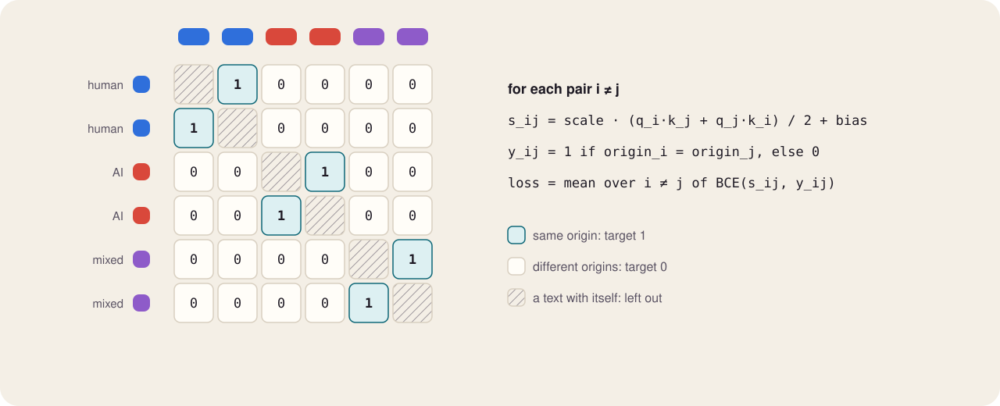
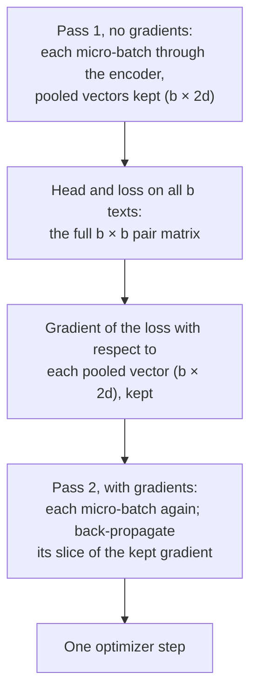

# 4. Training

[Front page](../TRAINING.md) · [1. Data](data.md) · [2. Splits](splits.md) · [3. Model](model.md) · **4. Training** ·
[5. Calibration](calibration.md) · [6. Experiments](experiments.md) · [7. Evaluation](evaluation.md) ·
[8. Engine](engine.md) · [9. Reproduce](reproduce.md)

Training adjusts the latent weights of the encoder and the head so that two texts of the same origin get a high pair
logit and two texts of different origins a low one. The model learns from the origins alone: one loss, over every
pair of texts in a training step, and beside it a masked language loss that teaches the same encoder to fill in
hidden tokens (no part of which ships). It is trained from scratch, with quantization in the forward pass from the
first step. The code is `student/src/litmus_student/train.py`.

- [The loss](#the-loss)
- [A 3 by 3 example](#a-3-by-3-example)
- [What a step draws](#what-a-step-draws)
- [Packing texts into blocks](#packing-texts-into-blocks)
- [The gradient-cached step](#the-gradient-cached-step)
- [Optimizer and schedule](#optimizer-and-schedule)
- [What is measured during training, and the checkpoint](#what-is-measured-during-training-and-the-checkpoint)
- [The release run](#the-release-run)
- [Where in the code](#where-in-the-code)

## The loss

A step holds $`b`$ training texts with origins $`y_1, \dots, y_b \in \{0, 1, 2\}`$ (human, AI, mixed). The model gives
each its unit query and key; stacked, $`Q`$ and $`K`$ are $`b \times w`$. All pair logits at once
([3. The model](model.md#the-pair-logit)):

```math
S = a_s \cdot \frac{Q K^{\top} + K Q^{\top}}{2} + b_s \qquad (b \times b)
```

Entry $`S_{ij}`$ is the logit that texts $`i`$ and $`j`$ share an origin. The **target** of each pair is whether they
do:

```math
Y_{ij} = \mathbf{1}[\,y_i = y_j\,] \qquad (b \times b)
```

The **true-label pair loss** is the binary cross-entropy of every pair against its target, averaged over the
$`b(b-1)`$ pairs of two different texts (a text with itself is left out):

```math
\mathcal{L}_{\mathrm{pair}} = \frac{1}{b(b-1)} \sum_{i \neq j} \Big[ -Y_{ij} \log \sigma(S_{ij}) - (1 - Y_{ij}) \log\big(1 - \sigma(S_{ij})\big) \Big]
```

and the loss the optimizer reduces is $`\mathcal{L} = \lambda\, \mathcal{L}_{\mathrm{pair}}`$, with $`\lambda`$ the weight
the distillation search's settings gave all terms together, put on this one ([E4](experiments.md#e4-distillation-from-a-frozen-teacher-against-labels-only)).
For the release, $`\lambda`$ = <!--litmus:record.training.loss_weight-->7.47<!--/litmus-->. The cross-entropy is computed
from the logits in a form that keeps the gradient of a confidently right pair
([Barron et al., 2026](https://arxiv.org/abs/2610.31642)), and equals the formula above.

Its gradient with respect to one logit is simply the error of that pair's probability:

```math
\frac{\partial \mathcal{L}}{\partial S_{ij}} = \lambda\, \frac{\sigma(S_{ij}) - Y_{ij}}{b(b-1)}
```

A step thus pulls together the queries and keys of every same-origin pair and pushes apart every different-origin
pair, in proportion to how wrong each is. One step with $`b = 1{,}024`$ texts trains on 1,047,552 pairs.

<picture>
  <source media="(prefers-color-scheme: dark)" srcset="../images/training/pair_matrix_dark.svg">
  
</picture>

*The targets of a step with two texts of each origin. The diagonal is left out; every other cell is one pair.*

| Symbol | What it is | Kind | Shape | Real size |
| --- | --- | --- | --- | --- |
| $`b`$ | Texts in a step | setting | | <!--litmus:record.training.texts_per_step as int-->1,024<!--/litmus--> |
| $`Q, K`$ | Unit queries and keys of the step's texts | computed | $`b \times w`$ each | |
| $`S`$ | Pair logits | computed | $`b \times b`$ | |
| $`Y`$ | Same-origin targets | computed from labels | $`b \times b`$ | |
| $`\lambda`$ | Loss weight | setting | scalar | <!--litmus:record.training.loss_weight-->7.47<!--/litmus--> |
| $`a_s, b_s`$ | Pair logit scale and bias | fixed after training | scalars | |

### The masked language loss

From 1.1 the same encoder also learns masked language modeling, so one model is the detector, a surprise model and
a base model for later work. In each step a share $`m`$ of the texts is chosen (at random, at every step, so a text
drawn again is masked anew), and in each chosen text 15% of the tokens: 80% of those become `[MASK]`, 10% a random
token and 10% stay (BERT's rule; `model.mask_stream`). The masked texts feed the pair loss as they are, so the pair
loss also learns from texts with holes. A head reads each chosen position's final state $`h`$: a ternary projection
to the embedding width $`e`$, a norm, and the token embedding's own rows $`E`$ as the output (tied, int8 as a
release stores them), with a learned scale $`a_m`$ and a bias $`c`$ per token:

```math
\ell = a_m\, E\, \mathrm{norm}(W_m h) + c, \qquad
\mathcal{L}_{\mathrm{mlm}} = \frac{1}{|M|} \sum_{p \in M} -\log \mathrm{softmax}(\ell_p)_{x_p}
```

over the step's chosen positions $`M`$ and their original tokens $`x_p`$. The loss the optimizer reduces is then
$`\lambda\, \mathcal{L}_{\mathrm{pair}} + \mu\, \mathcal{L}_{\mathrm{mlm}}`$; for the release, the share and weight are
<!--litmus:record.training.mlm-->half of each step's texts, chosen anew at every step, with 15% of their tokens chosen (80% `[MASK]`, 10% a random token, 10% kept), at weight 0.1 beside the pair loss's 7.47<!--/litmus-->. The head (`model.MaskedLanguageHead`) is saved in the
checkpoint and exported with the release (`mlm.*`), whose verdicts never read it: it gives a text's **surprise**, its
mean token log probability with nothing masked (the unmasked pseudo log likelihood), read in a pass of its own when a
reading's details are opened, and placed among each origin's calibration texts by the table `export.py` fits on the
`calibration` split (`../../student/SPEC.md`, Surprise).

<details>
<summary>More detail: the distillation terms, which the release does not use</summary>

The training code can also match a frozen **teacher** (ModernBERT-base and a pair head trained on its embeddings), with
four more terms beside the true-label one. Per text: the student's standardized pooled vector, through a learned
linear map, against the teacher's embedding ($`1 - \cos`$ plus mean squared error); and the student's query and key,
through learned maps, against the teacher's ($`1 - \cos`$). Per pair: the binary cross-entropy of the student's logit
against the teacher's probability $`\sigma(S^{T}_{ij} / \tau)`$; and a cross-entropy between each row's softmax over
the student's and the teacher's logits, which keeps the teacher's order of nearest texts. With default weights 1, 1,
1, 0.5, and 1 (true labels last). Trained against the same student on labels alone, the distilled student was level
or behind on every detection measure, so the release trains on labels alone
([E4](experiments.md#e4-distillation-from-a-frozen-teacher-against-labels-only)). The terms are in
`litmus_student.distill.distillation_losses`, and the switch is `train.py --labels-only`.

</details>

## A 3 by 3 example

Made-up numbers, computed with the formulas above. Three texts, two human and one AI, with toy query and key vectors
of width 2, scale $`a_s = 10`$, and bias $`b_s = -4`$. Text 3 is human but its vectors lean toward the AI text's.

| Text | Origin | Query $`q`$ | Key $`k`$ |
| --- | --- | --- | --- |
| 1 | human | (0.981, 0.196) | (0.992, −0.124) |
| 2 | AI | (−0.287, 0.958) | (−0.217, 0.976) |
| 3 | human | (0.530, 0.848) | (0.406, 0.914) |

The symmetric dot products $`(q_i^{\top} k_j + q_j^{\top} k_i) / 2`$, the logits, and the probabilities:

| Pair | Symmetric dot | Logit $`S_{ij}`$ | $`\sigma(S_{ij})`$ | Target $`Y_{ij}`$ | Loss | What it shows |
| --- | --- | --- | --- | --- | --- | --- |
| 1 and 2 | −0.213 | −6.13 | 0.002 | 0 | 0.002 | A different-origin pair scored correctly: almost no loss |
| 1 and 3 | 0.499 | 0.99 | 0.729 | 1 | 0.316 | A same-origin pair scored right but unsure: some loss |
| 2 and 3 | 0.736 | 3.36 | 0.966 | 0 | **3.391** | A different-origin pair scored as the same: a large loss |

Each pair appears twice in the matrix ($`S`$ is symmetric), so the six off-diagonal cells give

```math
\mathcal{L}_{\mathrm{pair}} = \frac{2 \times (0.002 + 0.316 + 3.391)}{6} = 1.236
```

and the gradients on the logits, $`(\sigma(S_{ij}) - Y_{ij}) / 6`$ per cell (with $`\lambda = 1`$), are $`+0.0004`$ for pair
1 and 2 (leave it), $`-0.045`$ for pair 1 and 3 (raise it), and $`+0.161`$ for pair 2 and 3 (lower it, most of all). The
optimizer therefore moves text 3's query and key away from the AI text's and toward text 1's.

## What a step draws

Each step draws $`b`$ texts from the training split, **a third of each origin** (the remainder to the first), so every
step sees all nine kinds of pair (human-human, human-AI, ..., mixed-mixed). Within an origin, texts are drawn
**uniformly**, so the step inherits the corpus's balance of format, language, length, and domain cell by cell. (An
option draws an origin's e-means clusters uniformly instead and one text within each; it is off, because each origin
would then get its own mix of cells, which a model can read as the origin.)

Eligible texts are training texts of at most 8,192 tokens, never a long document kept for evaluation. By default
texts are never cropped: a text is read whole, at its own length, from 8 to 8,192 tokens, as inference reads a chunk.

**The 1.1 release draws differently** (`--uniform`, `--texts`, `--cut-ends`, `--cut-starts`): <!--litmus:record.training.sampling-->each epoch is a new random order of every eligible training text (11.12 million, so 10,863 steps an epoch), whatever its origin, so a step holds the corpus's own mix, about 53% human, 46% AI and 1.4% mixed text (Logan, 2026-11-19: "uniform over all texts"); every draw is presented anew and perhaps cut (below), with a chance of 0.5 near its end and 0.25 near its start, so a text seen again in a later epoch is seen differently.<!--/litmus-->

Each draw of a training text is **presented anew** (`presentation.presented`, run in worker processes by
`data.Presenter` from a store of the corpus's texts), so that no trace of how a text was displayed or collected tells
its origin: Litmus 1.0.0 read Markdown, typography, spacing, line wrapping and how a text ends as evidence. Every
choice is drawn from a fresh seed, never from the label or the content:

- Markdown rendered as a reader copies it, or kept as written, at even odds; then, at any origin, a few phrases made
  bold (0.15) and a short first line made a heading (0.1).
- Prose paragraphs joined onto one line (0.75) or hard-wrapped at a width from 60 to 100 (0.25).
- Every dash of a text in one style of eight (`—`, ` — `, `–`, ` – `, ` - `, `-`, `--`, ` -- `); quotes curly or
  straight at even odds; ellipses `…` (0.3) or `...`; one space between sentences (0.85) or two.
- In 5% of texts, each word of four letters or more that a WordNet table holds swapped with probability 0.1 for a
  synonym of its commonest sense, its capital kept, never a function word or code.
- Code and code spans as written.

Then each text of 16 tokens or more is perhaps **cut mid-sentence** (`data.Cutter`): with one chance its tokens from a
word start in its last quarter are dropped, with another its tokens before a word start in its first quarter, at the
same rate for every origin. Validation, calibration, the reference set and test are never presented, swapped, cut or
masked: they are read as stored.

## Packing texts into blocks

A step's texts are packed into **micro-batches** of a fixed number of token positions (65,536 by default), each one
flat stream, so no position is spent on padding inside a block:

- A text longer than $`B/2`$ starts at a multiple of $`B`$, so its blocks are whole blocks of the stream under both
  shifts (0 and $`B/2`$).
- Texts of at most $`B/2`$ tokens share half-blocks, which no block of either shift splits.
- Long texts go first, largest first; short ones fill the free room, first fit, largest first.

Every layer reshapes the stream into blocks and attends under a mask of **same text and same text block**, so a token
never attends to another text or across its own text's block boundary, exactly as when the text is read alone. The
stream's length is padded to a multiple of 8,192 positions so that tensor shapes repeat.

## The gradient-cached step

The loss compares every pair of the step's texts, so it needs all $`b`$ queries and keys at once, but the activations
of a thousand texts of up to 8,192 tokens do not fit in a GPU's memory. **Gradient caching**
([Gao et al., 2021](https://arxiv.org/abs/2101.06983)) computes the exact gradient of the full-step loss with the
memory of one micro-batch:



*The step, exact: pass 2 gives each micro-batch's weights the gradient the full matrix assigns them.*

Because the pooled vectors are the only link between the encoder and the loss, the chain rule splits at them:
$`\partial \mathcal{L} / \partial \theta = \sum_{i} (\partial \mathcal{L} / \partial x_{\mathrm{pool},i})^{\top} \, \partial x_{\mathrm{pool},i} / \partial \theta`$.
Pass 1 gives the first factor for every text at once; pass 2 computes the second one micro-batch at a time. The cost
is one extra forward pass, about a third more compute. A memory bank of vectors from earlier steps would be cheaper,
but its vectors come from older weights and carry no gradient, so the step would no longer follow the gradient of its
own loss.

The encoder runs in bfloat16 autocast on the GPU; the head, the loss, and every quantization run in float32.

## Optimizer and schedule

**AdamW** with betas (0.9, 0.95), weight decay on matrices only (latent ternary weights, the embedding, the head's
weights), and the gradient's norm clipped at 1.0. The schedule follows the BitNet b1.58 training notes: a high peak
learning rate decaying linearly to zero, dropped to a lower peak at half the run, and weight decay removed at half
the run. With $`t`$ the step, $`T`$ the planned steps, $`t_w`$ the warmup steps, and peaks $`\eta_1 \gt  \eta_2`$:

```math
\eta(t) =
\begin{cases}
\eta_1 \, (t + 1) / t_w & t \lt  t_w \\
\eta_1 \, (1 - t / T) & t_w \le t \lt  T/2 \\
\eta_2 \, (1 - t / T) & t \ge T/2
\end{cases}
\qquad
\mathrm{wd}(t) =
\begin{cases}
0.1 & t \lt  T/2 \\
0 & t \ge T/2
\end{cases}
```

**The time box.** A run may be given minutes instead of steps. The schedules then read the step
$`\max\!\big(t,\ \min(T, \lfloor T \cdot \mathrm{elapsed} / \mathrm{box} \rfloor)\big)`$, so the learning rate reaches
zero when the box closes however fast the steps run, and the run ends with its low-rate tail instead of being cut off.

*Worked example* with the code's defaults, $`\eta_1 = 1.5 \times 10^{-3}`$, $`\eta_2 = 10^{-3}`$, $`t_w = 100`$, and
$`T = 10{,}000`$:

| Step $`t`$ | Rule | $`\eta(t)`$ | Weight decay |
| --- | --- | --- | --- |
| 50 | warmup, $`\eta_1 \cdot 51 / 100`$ | 7.65e-4 | 0.1 |
| 2,000 | $`\eta_1 \cdot 0.8`$ | 1.2e-3 | 0.1 |
| 4,999 | $`\eta_1 \cdot 0.5001`$ | 7.5e-4 | 0.1 |
| 5,000 | $`\eta_2 \cdot 0.5`$ | 5.0e-4 | 0 |
| 9,000 | $`\eta_2 \cdot 0.1`$ | 1.0e-4 | 0 |

## What is measured during training, and the checkpoint

Every few hundred steps the run reads a fixed **validation** set the same way each time:

1. **The validation loss**: the training loss on a fixed draw of validation texts (4,096 by default).
2. **Detection through the bank**: a bank and validation texts (3,000 per origin by default, spread evenly over
   clusters) are read in evaluation mode, every text chunked as inference reads it. By default the bank is 4,096 texts
   per origin of the bank split, spread evenly over clusters; with `--bank-recipe`, it is the bank the export draws by
   that recipe for the same seed and size, which is how the release run read its own bank (the withheld reference
   set, `reference`, embedded again with the current weights at every reading). From
   $`\mathrm{score} = 1 - r_{\mathrm{human}}`$: PR AUC, ROC AUC, and balanced MCC of AI or mixed text against human
   text, and the PR AUC of human against AI alone ([7. Evaluation](evaluation.md#the-metrics) defines each). When a
   run is given a teacher, the frozen teacher's numbers on the same texts and bank are logged beside them; the release
   run had no teacher.

By default the run keeps the checkpoint with the **lowest validation loss** (`best.pt`) and the latest (`last.pt`).
With `--select pr_auc` it keeps the reading of the **highest validation PR AUC** instead, and with `--patience n` it
stops once $`n`$ readings in a row bring no better one; `--eval-every-epochs` sets the interval as a share of an
epoch. Test is never read during training. When a teacher is given, the code's rule for choosing among sizes is the
smallest student within 0.01 PR AUC of the teacher on validation, human against AI.
How the release was chosen: <!--litmus:record.training.selection-->on validation PR AUC of AI or mixed against human, read every half epoch against the withheld reference set embedded again (Logan, 2026-11-19: "validation every 0.5 epoch, reembed reference set every 0.5 epoch for validation, done when patience of 3 is exceeded on validation PR AUC"): the readings were 0.9075, 0.9187, 0.9312, 0.9346, 0.9433, 0.9458, 0.9502 and 0.9506, each a new best, so patience was never exceeded, training ended at the four-epoch cap, and the release is the best reading, the last step (43,452)<!--/litmus-->.

## The release run

| Setting | Code default | Release |
| --- | --- | --- |
| Configuration | | <!--litmus:model.config_name-->s512_l6<!--/litmus--> |
| Teacher | a teacher export and the four distillation terms, unless `--labels-only` | <!--litmus:record.model.teacher-->None: this release is trained on the true labels alone; labels alone read level with or ahead of distillation at equal steps (E4), and the second build has no teacher export<!--/litmus--> |
| Weights | ternary, absmean | <!--litmus:record.ablations.a1.outcome-->ternary, absmean (A1)<!--/litmus--> |
| Precision schedule | quantized from step 0 | <!--litmus:record.ablations.a2.outcome-->quantized from step 0 (A2)<!--/litmus--> |
| Pooling | mean and variance | <!--litmus:record.ablations.a3.outcome-->mean and variance (A3)<!--/litmus--> |
| Head widths $`d_{\mathrm{hid}}`$, $`w`$, clamp | 512, 128, 10 | <!--litmus:record.ablations.a4.outcome-->256, 64, 30 (A4 and E8)<!--/litmus--> |
| Attention | float | <!--litmus:model.attention-->integer<!--/litmus--> |
| Query and key output | float | <!--litmus:model.output-->int8<!--/litmus--> |
| Texts per step $`b`$ | 2,048 | <!--litmus:record.training.texts_per_step as int-->1,024<!--/litmus--> |
| Masked language modeling | none | <!--litmus:record.training.mlm-->half of each step's texts, chosen anew at every step, with 15% of their tokens chosen (80% `[MASK]`, 10% a random token, 10% kept), at weight 0.1 beside the pair loss's 7.47<!--/litmus--> |
| Drawing | a third of each origin, uniform within one | <!--litmus:record.training.draws-->uniform over every training text in epochs, whatever its origin (`--uniform`)<!--/litmus--> |
| Micro-batch | 65,536 positions | <!--litmus:record.training.micro_batch-->65,536 positions<!--/litmus--> |
| Peaks $`\eta_1`$, $`\eta_2`$; warmup | 1.5e-3, 1e-3; 100 steps | <!--litmus:record.training.peaks_warmup-->1.5e-3, 1e-3; 100 steps (the search's schedule settings were not taken)<!--/litmus--> |
| Steps or time box | 2,000 steps | <!--litmus:record.training.steps_or_box-->four epochs, at most 43,452 steps, with patience 3 on validation PR AUC; ended at the cap after 19 h 30 min, still improving<!--/litmus--> |
| Evaluation interval | 250 steps | <!--litmus:record.training.eval_interval-->half an epoch, 5,431 steps<!--/litmus--> |
| Seed | 0 | <!--litmus:record.training.seed-->0<!--/litmus--> |
| Steps run, texts and tokens seen | | <!--litmus:record.training.seen-->43,452 steps of 1,024 texts, 44.5 million draws: four passes over every training text, each pass in a new order and every draw presented anew; about 1.1e10 tokens (about 156,000 a second for 19 h 30 min)<!--/litmus--> |
| Chosen checkpoint (step) and its validation numbers | | <!--litmus:record.training.chosen-->The last step, 43,452, the end of the fourth epoch: training's validation PR AUC 0.9506 (ROC AUC 0.9147, balanced MCC 0.6545); its release on validation reads PR AUC 0.9518, ROC AUC 0.9113 and balanced MCC 0.6175 (6,000 passages, AI or mixed against human)<!--/litmus--> |
| GPU and wall time | | <!--litmus:record.training.compute-->One NVIDIA GH200: 19 h 30 min of training at about 156,000 training tokens a second<!--/litmus--> |

## Where in the code

| What | Function (`litmus_student`) |
| --- | --- |
| Pair logits $`S`$ | `distill.pair_logits` |
| Targets $`Y`$ | `distill.same_origin` |
| The loss, and the distillation terms | `distill.distillation_losses`; the release's weights: `train.labels_only` |
| Binary cross-entropy from logits | `foundry.layers.cross_entropy.binary_cross_entropy_with_logits` |
| Drawing a step's texts | `data.ClusterSampler.draw`; the release's epochs: `data.EpochSampler` |
| Presenting each draw anew; synonyms; cuts | `data.Presenter`, `presentation.presented`, `presentation.swapped`; `data.Cutter` |
| Masked language modeling | `model.mask_stream`, `model.MaskedLanguageHead`, `train.Masking` |
| Packing into block-aligned streams | `data.pack`, `data.packed_batch`; the mask `model.block_mask` |
| The gradient-cached step | `train.train_step` |
| Learning rate, weight decay, time box | `train.learning_rate`, `train.weight_decay`, `train.scheduled_step` |
| Weight decay on matrices only | `train.parameter_groups` |
| Validation readings and metrics | `train.Evaluation`, `train.chunked_shares`, `train.detection_metrics` |
| Checkpoints and the size rule | `train.save_checkpoint`, `train.release_margin` |

---

Previous: [3. The model](model.md) · Next: [5. Calibration and the reading](calibration.md)
